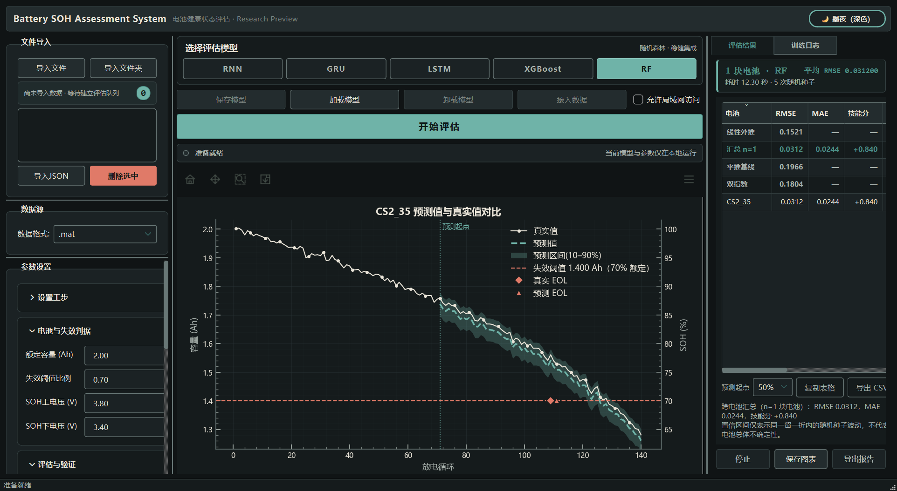
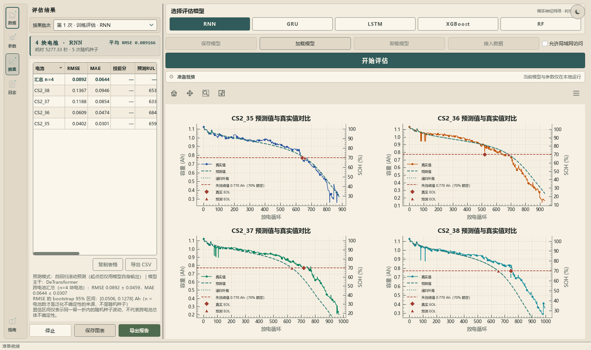
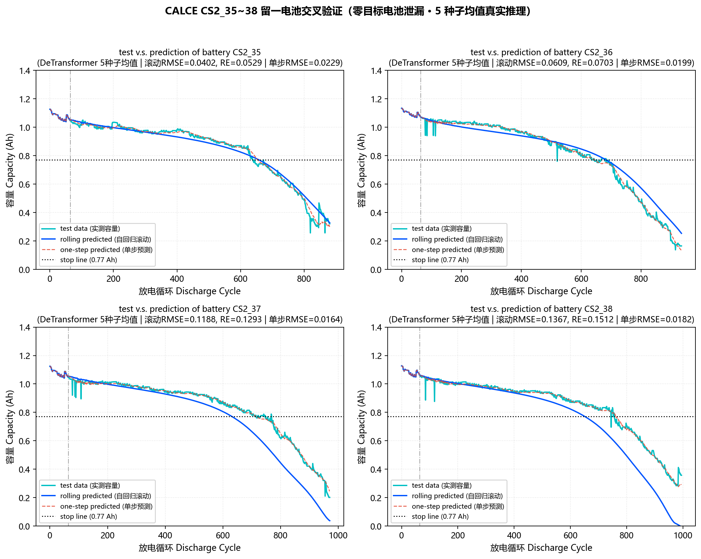

# Battery SOH Assessment System

> 电池健康状态评估系统

语言：中文 · [English](README_EN.md)

基于马里兰大学 CALCE 锂电池充放电数据集，采用 PyQt6 设计 UI 界面，支持 **RNN / GRU / LSTM / DeTransformer**（PyTorch）及 **XGBoost / RF（Random Forest）**（scikit-learn）模型，对锂离子电池循环充放电数据进行容量退化趋势预测并计算剩余使用寿命（RUL）。采用留一法（Leave-One-Out）跨电池验证，并提供多种评估指标与 95% 置信区间分析。

浅色（宣纸）与深色（墨夜）两套主题，颜色集中在 [`theme_tokens.py`](theme_tokens.py)。**默认深色（墨夜）**，右上角按钮一键切换（快捷键 `Ctrl+T`），选择会被记住：

| 深色 · 墨夜（默认） | 浅色 · 宣纸 |
|---|---|
|  |  |

截图由 `python tools/render_screenshots.py` 重新生成（真实主界面渲染，非示意图）。中文字体由 `ui/fonts.py` 在启动时显式注册——PyQt6 的 offscreen 平台插件不使用系统字体引擎，不注册就会满屏方框。

> [!IMPORTANT]
> 本项目是面向教学、科研与离线算法验证的 Research Preview。当前严格零样本基准显示一步容量预测较稳定，但常规 RNN 递归 RUL 外推误差仍然很大；结果不得直接用于 BMS 安全保护、质保、报废或其他安全关键决策。TCP 实时接入属于实验功能，请勿暴露到不可信网络。

## 评估协议（请先读这一节）

这一节说明结果是怎么算出来的、哪些数字可以信、哪些不能信。**评估路径与部署路径共用同一套流程**（`core/protocol.py::fit_final`），因此报告的模型拟合行为与最终导出模型一致。

### 外层：留一电池（LOBO）

对每块目标电池建一折：目标电池**全程不参与**任何拟合、scaler 拟合、超参选择或种子选择，只在模型定型后评估一次。scaler 只用训练电池拟合。

### 定型：全量训练窗口重训（无目标电池泄漏）

早期实现曾把每块训练电池切成「前 80% 训练 + 后 20% 验证」，而电池寿命末段（膝点）恰好落在后 20%，导致模型在评估时从未见过寿命末段却被要求预测失效阈值。修正后，默认评估与部署共用 `core/protocol.py::fit_final`，使用**全部训练电池的全部窗口**定型。

- UI 默认主流程（`core/train.py`）直接使用配置超参定型（跳过内层交叉验证与 α 收缩，与原始工程协议及 `XiuzeZhou/RUL` 对齐）；
- 若需做多起点滚动评估与持久性混合系数 α 标定，`core/protocol.py` 另提供内层留一电池交叉验证（`select_hparams`）与多步滚动标定（`choose_blend_by_rollout`），可通过 `python tools/repro_synthetic.py` 复现对照。

### 预测模式与指标口径（一步预测 vs 递归外推）

**UI 默认显示一步预测；RUL / RE 统一用递归外推；基准表两种都报**（`core/train.py::evaluate_prediction_protocols`）：

- **一步预测（`prediction_mode='one_step'`，UI 默认）**：每一步输入截至该点的真实历史窗口，拟合 RMSE / MAE / R² / Pearson 指标较稳定，与旧项目及 `XiuzeZhou/RUL` 的口径保持一致。UI 可在配置中切换为 `rolling`（自回归滚动预测）；
- **递归预测（`recursive` / `rolling`）**：只给起点之前的实测窗口，之后把模型自己的预测容量回填进窗口，用于观察误差累积形态；**RUL 与失效相对误差 RE 始终基于递归外推计算**（`rul_protocol='recursive_future'`），不以一步预测替代寿命结论；
- **滚动起点评估工具（`core/protocol.py::rolling_origin_eval`）**：支持在寿命 40% / 50% / 60% / 70% 起点做多起点递归评估，用于基准对照与协议研究。

### 基线：任何模型都必须先赢过它们

`core/baselines.py` 与 `ui/result_model.py` 支持并排对照三条经验基线：**平推基线**（下一个循环 = 上一个循环）、**线性外推**、**双指数** `C(k)=a·e^{bk}+c·e^{dk}`。

技能分 = `1 − RMSE模型 / RMSE平推`。技能分 < 0.05 的单元格会显示 ⚠ 并提示「模型未超越持久性基线」。

### 持久性混合系数 α（滚动协议可选机制）

在滚动评估协议（`core/protocol.py::choose_blend_by_rollout`）中，α ∈ `[0, 1]` 把预测向「上一循环容量」收缩，并通过内层留一折的**多步滚动误差**标定，避免「一步标定、多步使用」导致的坍缩（默认 UI 主流程 `core/train.py` 中固定 `persistence_blend=1.0`，即保留原模型输出）。

> 在 `tools/repro_synthetic.py` 合成数据对照中，早期按一步误差标定在 4/4 折上的 α 全是 `0.000`（模型被丢弃）；改用多步滚动误差后同一批数据的 α 落在 0.72–0.80。

### 指标与失效语义

- RMSE / MAE / R² / Pearson 对输入长度、有限性与常数序列有保护；
- **右删失是显式状态**：区分 `observed` / `observed_censored` / `prediction_censored` / `both_censored` / `observed_initial_failure` / `prediction_initial_failure`，界面显示 `N/A（截尾）`，不把「没失效」硬当成 0 或 −1；
- **RUL** = 从预测起点到 EOL 还有多少个循环（真正的剩余寿命），不是旧实现里「SOH 从 pct% 掉到失效阈值（如历史常用的 80%）需要多少个循环」；
- **SOH** 一律定义为 `C / C_rated`；
- **失效判定只有一处实现**（`core/result_semantics.py`），`core/protocol.py`、`core/evaluate.py`、`ui/result_model.py` 全部委托到它，避免多份逻辑各自漂移；
- **失效判定去抖可选**（`TrainConfig.eol_debounce`，默认 `1`）：设为 `3` 时要求**连续 3 个循环**低于阈值才算失效，避免单点噪声把 EOL 提前。返回值仍是首次下穿处，所以开启去抖不会让报告的失效循环偏晚；
- **离群点默认采用分块 2σ 剔除**（`outlier_mode='chunked'`）：`config.json` 与 `TrainConfig` 均默认使用 `chunked`（每 40 个循环分块计算均值±2σ 并保护持续退化膝点，使容量曲线平滑并与参考实现一致）。`mark`（仅标记不删除，只用历史至多 40 个循环；亦为 `core/adapters.py` / `core/dataload.py` 未传参直接调用时的函数签名默认值）、`delete`（因果滑窗剔除）与 `off`（仅去 `NaN`/`Inf`）作为**可选项**保留，审计信息存储在 `frame.attrs['outlier_audit']`。

### 不确定性：n = 电池数，不是随机种子

- 多种子 95% CI 只反映**同一留一折内的随机种子波动**，它很窄，**不代表**泛化不确定性；
- 真正的不确定性来自「换一块电池会怎样」，因此跨电池汇总给出 mean ± std 与 **bootstrap 区间**（`n = 电池数`）。电池只有 4–5 块时区间会很宽——这是诚实的。

### 复现本节的对照实验

```powershell
python tools/repro_synthetic.py
```

在合成「NASA 风格」电池上复现「现有流程 vs 建议流程」的四方对比，输出 α 值、各起点的 RMSE 与 EOL 检出情况。数据是合成的，只验证**机制**；把脚本里的 `make_battery` 换成你的真实 `battery_dict` 就是真实数据上的对比。

### 局限

- 没有接触真实 BMS、CAN、HIL 或台架数据，软件测试证据不能替代安全认证证据；
- 一步容量拟合好**不等于** RUL 递归外推可靠；
- 对「训练集里没有的极端电池」做外推依然很难——协议修复不是万能的；
- 多特征递归预测时，非容量通道保持窗口末值（未来工况未知时的保守假设）。

### 质量门禁

```powershell
python tools/check_undefined.py core models ui utils theme_tokens.py battery_soh_app.py  # 找"用了但从未定义"的全局名字
python tools/check_colors.py                                                             # 硬编码颜色必须只出现在 theme_tokens.py
python tools/sync_readme_defaults.py --check                                             # 校验 README 默认参数表与代码/config.json 一致
python -m unittest discover -s tests                                                     # 回归测试
```

## 默认参数与代码位置

下表汇总当前代码实际生效的运行时默认值（`config.json`，UI 启动加载）与 `TrainConfig` 类默认值（`utils/config.py`），并注明仅有的签名/历史差异：

<!-- DEFAULTS:BEGIN -->
> 本表由 `python tools/sync_readme_defaults.py` 自动从 `config.json` 与 `utils/config.py::TrainConfig` 生成（CI 通过 `--check` 校验一致性）。

| 参数 | 实际运行时默认值 (`config.json` / UI) | `TrainConfig` 类默认值 | 说明与代码位置 |
|---|---|---|---|
| `rated_capacity` | `1.1` | `1.1` | 额定容量 (Ah)（`config.json`, `utils/config.py`） |
| `threshold_ratio` | `0.7` | `0.8` | 失效阈值比例（UI 启动加载 `config.json` 的 `0.7`；历史 `5681172` 基准与未加载配置时的 `TrainConfig`/模型保存回退为 `0.8`）（`config.json`, `utils/config.py`, `ui/main_window.py`） |
| `voltage_upper` | `3.8` | `3.8` | 健康指标 `dq_v` 上电压 (V)（`config.json`, `utils/config.py`） |
| `voltage_lower` | `3.4` | `3.4` | 健康指标 `dq_v` 下电压 (V)（`config.json`, `utils/config.py`） |
| `window_size` | `64` | `64` | 历史输入滑窗长度（循环数）（`config.json`, `utils/config.py`） |
| `epochs` | `100` | `100` | 深度学习训练轮数（`config.json`, `utils/config.py`） |
| `hidden_dim` | `64` | `64` | RNN / DeTransformer 隐层维度（`config.json`, `utils/config.py`） |
| `mode` | `RNN` | `RNN` | 默认评估模型（`config.json`, `utils/config.py`） |
| `metric` | `all` | `rmse` | 默认展示指标（`config.json` 为 `all`，类默认为 `rmse`）（`config.json`, `utils/config.py`） |
| `device` | `cpu` | `cpu` | 默认计算设备（`cpu` / `cuda`）（`config.json`, `utils/config.py`） |
| `seed` | `2` | `2` | 起始随机种子（`config.json`, `utils/config.py`） |
| `n_seeds` | `1` | `5` | 多种子重复次数（UI 启动加载 `config.json` 的 `1`；类默认 `5`；基准测试用 `5`）（`config.json`, `utils/config.py`） |
| `patience` | `20` | `20` | XGBoost 早停轮数（保留配置项）（`config.json`, `utils/config.py`） |
| `norm_method` | `rated` | `rated` | 容量归一化方式（`rated` / `minmax` / `zscore`）（`config.json`, `utils/config.py`） |
| `n_estimators` | `100` | `100` | 树模型集成数量（XGBoost / RF）（`config.json`, `utils/config.py`） |
| `learning_rate` | `0.1` | `0.1` | XGBoost 学习率（`config.json`, `utils/config.py`） |
| `max_depth` | `6` | `6` | 树最大深度（XGBoost / RF）（`config.json`, `utils/config.py`） |
| `subsample` | `1.0` | `1.0` | XGBoost 样本采样比例（`config.json`, `utils/config.py`） |
| `colsample_bytree` | `1.0` | `1.0` | XGBoost 特征采样比例（`config.json`, `utils/config.py`） |
| `min_samples_leaf` | `1` | `1` | RF 叶子节点最小样本数（`config.json`, `utils/config.py`） |
| `max_features` | `1.0` | `1.0` | RF 分裂最大特征比例（`config.json`, `utils/config.py`） |
| `rnn_lr` | `0.001` *（继承自 `TrainConfig`）* | `0.001` | 深度学习 Adam 学习率（仅 `TrainConfig`）（`utils/config.py`） |
| `rnn_dropout` | `0.1` *（继承自 `TrainConfig`）* | `0.1` | 深度学习 Dropout 比例（仅 `TrainConfig`）（`utils/config.py`） |
| `feature_columns` | `['capacity']` | `['capacity']` | 输入特征列（默认仅容量，保持纯自回归）（`config.json`, `utils/config.py`） |
| `eol_debounce` | `1` *（继承自 `TrainConfig`）* | `1` | EOL 连续低于阈值确认循环数（仅 `TrainConfig` / `core/result_semantics.py`）（`utils/config.py`, `core/result_semantics.py`） |
| `adapter_type` | `CALCE` | `CALCE` | 默认数据适配器（`CALCE` / `NASA`）（`config.json`, `utils/config.py`） |
| `cc_step` | `2` | `None` | CALCE 恒流充电工步序号（`config.json`, `utils/config.py`） |
| `cv_step` | `4` | `None` | CALCE 恒压充电工步序号（`config.json`, `utils/config.py`） |
| `discharge_step` | `7` | `None` | CALCE 放电工步序号（`config.json`, `utils/config.py`） |
| `outlier_mode` | `chunked` | `chunked` | 离群点处理：UI/评估运行时由 `TrainConfig` 与 `ui/worker.py` 传入 `chunked`；直接调用 `adapters.py`/`dataload.py` 未传参时签名默认为 `mark`（`config.json`, `utils/config.py`, `ui/worker.py`, `core/adapters.py`） |
| `backbone` | `default` | `default` | 神经网络主干（`default` / `Transformer` / `DeTransformer`）（`config.json`, `utils/config.py`, `core/model_factory.py`） |
| `num_layers` | `1` | `1` | 循环/Transformer 层数（`config.json`, `utils/config.py`） |
| `nhead` | `1` | `1` | Transformer 注意力头数（`config.json`, `utils/config.py`） |
| `transformer_k` | `16` | `16` | DeTransformer 单变量通道复制系数 K（`config.json`, `utils/config.py`） |
| `alpha` | `0.1` | `0.1` | DeTransformer 自编码器重构损失权重 α（`config.json`, `utils/config.py`） |
| `noise_level` | `0.0` | `0.0` | DeTransformer 自编码器输入噪声强度（`config.json`, `utils/config.py`） |
| `weight_decay` | `0.0` | `0.0` | 深度学习 Adam 权重衰减（`config.json`, `utils/config.py`） |
| `prediction_mode` | `one_step` | `one_step` | UI 默认展示指标口径：`one_step`（一步预测拟合指标 + 递归 RUL/RE）；可选 `rolling`（`config.json`, `utils/config.py`, `core/train.py`） |

> **关于 `outlier_mode` 的实际调用路径**：`config.json` 与 `TrainConfig` 默认均为 `chunked`，UI 与训练线程 `ui/worker.py` 运行时显式传入 `config.outlier_mode`，因此**实际运行走 `chunked`**；仅当绕过 `TrainConfig` 直接调用 `core/dataload.py`（`mark`）、`CALCEAdapter.load_battery_data`（`mark`）或 `NASAAdapter.load_battery_data`（`mark`）且不传参时，才使用函数签名默认值 `mark`。
<!-- DEFAULTS:END -->

## 严格零样本基准（Benchmark）

本基准使用严格零样本跨电池评估（留一电池验证）：目标电池不参与训练、归一化拟合、调参或种子选择。同时报告**一步预测**（与 UI 默认口径一致）与**多起点递归外推**（寿命 40% / 50% / 60% / 70% 起点的滚动 RMSE 及相对平推基线的技能分，技能分 `< 0.05` 标 ⚠），并用全轨迹递归计算 RUL / RE 与显式右删失状态。所有预定种子均计入均值，括号或 `±` 表示同一留一折内的种子波动。

复跑入口：`python scripts/run_strict_benchmark.py --n-seeds 5`（输出至 `benchmark/results_<短commit>.json`，由 `python tools/render_benchmark_table.py` 同步下表）。

<!-- BENCH:BEGIN -->
> 来源文件：[`benchmark/results_cbcbfa9.json`](benchmark/results_cbcbfa9.json) · 提交：`cbcbfa9` · 协议：`strict_zero_shot_leave_one_battery_out` · 阈值比例：`0.7` · 离群点模式：`chunked`

### 宏平均总览（6 个模型 + 3 条经验基线，CALCE `CS2_35`–`CS2_38` 留一电池，5 种子均值）

| 模型 / 基线 | 一步 RMSE ↓ | 一步 MAE ↓ | 一步 R² ↑ | 40% 递归 RMSE | 50% 递归 RMSE | 60% 递归 RMSE | 70% 递归 RMSE | 平均技能分 ↑ | 递归 RE ↓ |
|---|---:|---:|---:|---:|---:|---:|---:|---:|---:|
| **RNN** | 0.0205 | 0.0152 | 0.9916 | 0.2796 | 0.3115 | 0.3479 | 0.3948 | +0.028 ⚠ | 43.46% |
| **GRU** | 0.0820 | 0.0618 | 0.8700 | 0.2745 | 0.2976 | 0.3316 | 0.3819 | +0.061 | — |
| **LSTM** | 0.1036 | 0.0767 | 0.8040 | 0.2681 | 0.2897 | 0.3223 | 0.3715 | +0.086 | — |
| **XGBoost** | 0.0148 | 0.0084 | 0.9959 | 0.2813 | 0.1942 | 0.1085 | 0.1289 | +0.483 | — |
| **RF** | 0.0139 | 0.0074 | 0.9965 | 0.3428 | 0.3520 | 0.3173 | 0.3169 | +0.033 ⚠ | — |
| **DeTransformer** | 0.0191 | 0.0121 | 0.9931 | 0.1234 | 0.0929 | 0.0662 | 0.0595 | +0.752 | 17.79% |
| 平推基线 | 0.0132 | 0.0050 | 0.9969 | 0.3478 | 0.3554 | 0.3363 | 0.3329 | +0.000（基线） | — |
| 线性外推 | 0.0132 | 0.0049 | 0.9969 | 0.3272 | 0.2339 | 0.1435 | 0.1889 | +0.352 | 24.78% |
| 双指数 | — | — | — | 0.2822 | 0.2680 | 0.2291 | 0.1634 | +0.312 | — |

### 分起点技能分（相对平推基线 `1 − RMSE模型 / RMSE平推`，`< 0.05` 标 ⚠）

| 模型 / 基线 | 40% 起点 | 50% 起点 | 60% 起点 | 70% 起点 | 宏平均技能分 |
|---|---:|---:|---:|---:|---:|
| **RNN** | +0.199 | +0.127 | -0.031 ⚠ | -0.184 ⚠ | +0.028 ⚠ |
| **GRU** | +0.210 | +0.164 | +0.016 ⚠ | -0.145 ⚠ | +0.061 |
| **LSTM** | +0.229 | +0.187 | +0.044 ⚠ | -0.114 ⚠ | +0.086 |
| **XGBoost** | +0.206 | +0.445 | +0.675 | +0.605 | +0.483 |
| **RF** | +0.016 ⚠ | +0.009 ⚠ | +0.057 | +0.050 ⚠ | +0.033 ⚠ |
| **DeTransformer** | +0.655 | +0.735 | +0.800 | +0.816 | +0.752 |
| 线性外推 | +0.054 | +0.343 | +0.571 | +0.438 | +0.352 |
| 双指数 | +0.193 | +0.237 | +0.311 | +0.509 | +0.312 |

<details>
<summary>展开查看各「模型 × 电池」完整明细（一步指标、40%–70% 递归 RMSE/技能分、RUL 与截尾状态）</summary>

| 模型 | 电池 | 循环 | 一步 RMSE | 一步 MAE | 一步 R² | 40% RMSE (技能) | 50% RMSE (技能) | 60% RMSE (技能) | 70% RMSE (技能) | 预测 EOL | 真实 EOL | 递归 RE | 截尾状态 |
|---|---|---:|---:|---:|---:|---|---|---|---|---:|---:|---:|---|
| RNN | CS2_35 | 896 | 0.0205 ± 0.0069 | 0.0146 ± 0.0070 | 0.9900 ± 0.0072 | 0.2479 (+0.225) | 0.2750 (+0.161) | 0.3085 (+0.052) | 0.3519 (-0.142 ⚠) | 449 | 641 | 33.33% ± 0.00% | 多种子混合 |
| RNN | CS2_36 | 941 | 0.0222 ± 0.0059 | 0.0167 ± 0.0058 | 0.9926 ± 0.0041 | 0.3412 (+0.164) | 0.3731 (+0.039 ⚠) | 0.4135 (-0.144 ⚠) | 0.4625 (-0.303 ⚠) | N/A（截尾） | 517 | — | 预测删失 |
| RNN | CS2_37 | 1008 | 0.0204 ± 0.0058 | 0.0153 ± 0.0051 | 0.9921 ± 0.0045 | 0.2853 (+0.176) | 0.3181 (+0.127) | 0.3557 (-0.049 ⚠) | 0.4017 (-0.213 ⚠) | 388 | 715 | 50.31% ± 0.00% | 多种子混合 |
| RNN | CS2_38 | 1038 | 0.0190 ± 0.0070 | 0.0141 ± 0.0068 | 0.9918 ± 0.0065 | 0.2441 (+0.230) | 0.2799 (+0.180) | 0.3140 (+0.016 ⚠) | 0.3633 (-0.077 ⚠) | 431 | 752 | 46.72% ± 0.00% | 多种子混合 |
| GRU | CS2_35 | 896 | 0.0688 ± 0.0226 | 0.0529 ± 0.0185 | 0.8882 ± 0.0633 | 0.2457 (+0.232) | 0.2645 (+0.193) | 0.2939 (+0.097) | 0.3390 (-0.100 ⚠) | N/A（截尾） | 641 | — | 预测删失 |
| GRU | CS2_36 | 941 | 0.1039 ± 0.0255 | 0.0792 ± 0.0196 | 0.8401 ± 0.0725 | 0.3126 (+0.234) | 0.3398 (+0.125) | 0.3794 (-0.050 ⚠) | 0.4363 (-0.229 ⚠) | N/A（截尾） | 517 | — | 预测删失 |
| GRU | CS2_37 | 1008 | 0.0840 ± 0.0236 | 0.0614 ± 0.0178 | 0.8659 ± 0.0676 | 0.2830 (+0.182) | 0.3078 (+0.155) | 0.3430 (-0.012 ⚠) | 0.3950 (-0.193 ⚠) | N/A（截尾） | 715 | — | 预测删失 |
| GRU | CS2_38 | 1038 | 0.0714 ± 0.0230 | 0.0536 ± 0.0179 | 0.8859 ± 0.0638 | 0.2567 (+0.191) | 0.2783 (+0.184) | 0.3099 (+0.029 ⚠) | 0.3574 (-0.059 ⚠) | N/A（截尾） | 752 | — | 预测删失 |
| LSTM | CS2_35 | 896 | 0.0860 ± 0.0109 | 0.0649 ± 0.0121 | 0.8372 ± 0.0394 | 0.2392 (+0.252) | 0.2561 (+0.218) | 0.2839 (+0.128) | 0.3275 (-0.062 ⚠) | N/A（截尾） | 641 | — | 预测删失 |
| LSTM | CS2_36 | 941 | 0.1321 ± 0.0104 | 0.0996 ± 0.0066 | 0.7518 ± 0.0401 | 0.3067 (+0.249) | 0.3327 (+0.143) | 0.3714 (-0.028 ⚠) | 0.4274 (-0.204 ⚠) | N/A（截尾） | 517 | — | 预测删失 |
| LSTM | CS2_37 | 1008 | 0.1068 ± 0.0104 | 0.0764 ± 0.0082 | 0.7950 ± 0.0397 | 0.2764 (+0.202) | 0.2998 (+0.177) | 0.3338 (+0.015 ⚠) | 0.3847 (-0.162 ⚠) | N/A（截尾） | 715 | — | 预测删失 |
| LSTM | CS2_38 | 1038 | 0.0896 ± 0.0111 | 0.0659 ± 0.0111 | 0.8320 ± 0.0398 | 0.2500 (+0.212) | 0.2700 (+0.209) | 0.3001 (+0.060) | 0.3462 (-0.026 ⚠) | N/A（截尾） | 752 | — | 预测删失 |
| XGBoost | CS2_35 | 896 | 0.0161 ± 0.0000 | 0.0093 ± 0.0000 | 0.9944 ± 0.0000 | 0.3038 (+0.050 ⚠) | 0.3328 (-0.016 ⚠) | 0.1948 (+0.402) | 0.2091 (+0.322) | N/A（截尾） | 641 | — | 预测删失 |
| XGBoost | CS2_36 | 941 | 0.0160 ± 0.0000 | 0.0092 ± 0.0000 | 0.9964 ± 0.0000 | 0.3866 (+0.053) | 0.2069 (+0.467) | 0.0739 (+0.796) | 0.0837 (+0.764) | N/A（截尾） | 517 | — | 预测删失 |
| XGBoost | CS2_37 | 1008 | 0.0125 ± 0.0000 | 0.0067 ± 0.0000 | 0.9972 ± 0.0000 | 0.3454 (+0.002 ⚠) | 0.1255 (+0.655) | 0.1129 (+0.667) | 0.1179 (+0.644) | N/A（截尾） | 715 | — | 预测删失 |
| XGBoost | CS2_38 | 1038 | 0.0145 ± 0.0000 | 0.0084 ± 0.0000 | 0.9956 ± 0.0000 | 0.0893 (+0.719) | 0.1116 (+0.673) | 0.0525 (+0.836) | 0.1048 (+0.689) | N/A（截尾） | 752 | — | 预测删失 |
| RF | CS2_35 | 896 | 0.0136 ± 0.0002 | 0.0071 ± 0.0002 | 0.9960 ± 0.0001 | 0.3052 (+0.045 ⚠) | 0.3344 (-0.020 ⚠) | 0.2801 (+0.139) | 0.2773 (+0.100) | N/A（截尾） | 641 | — | 预测删失 |
| RF | CS2_36 | 941 | 0.0164 ± 0.0002 | 0.0089 ± 0.0001 | 0.9962 ± 0.0001 | 0.4080 (+0.001 ⚠) | 0.3858 (+0.006 ⚠) | 0.3397 (+0.060) | 0.3537 (+0.003 ⚠) | N/A（截尾） | 517 | — | 预测删失 |
| RF | CS2_37 | 1008 | 0.0125 ± 0.0001 | 0.0065 ± 0.0001 | 0.9972 ± 0.0000 | 0.3449 (+0.004 ⚠) | 0.3476 (+0.046 ⚠) | 0.3352 (+0.011 ⚠) | 0.3252 (+0.018 ⚠) | N/A（截尾） | 715 | — | 预测删失 |
| RF | CS2_38 | 1038 | 0.0130 ± 0.0001 | 0.0071 ± 0.0001 | 0.9965 ± 0.0001 | 0.3130 (+0.013 ⚠) | 0.3403 (+0.003 ⚠) | 0.3142 (+0.016 ⚠) | 0.3114 (+0.077) | N/A（截尾） | 752 | — | 预测删失 |
| DeTransformer | CS2_35 | 896 | 0.0218 ± 0.0008 | 0.0138 ± 0.0005 | 0.9896 ± 0.0008 | 0.0676 (+0.788) | 0.1637 (+0.500) | 0.0871 (+0.733) | 0.1154 (+0.626) | 686.4 | 641 | 7.88% ± 3.16% | 已观测 |
| DeTransformer | CS2_36 | 941 | 0.0196 ± 0.0006 | 0.0128 ± 0.0006 | 0.9946 ± 0.0003 | 0.2229 (+0.454) | 0.1132 (+0.709) | 0.0444 (+0.877) | 0.0379 (+0.893) | 705.8 | 517 | 41.77% ± 1.36% | 已观测 |
| DeTransformer | CS2_37 | 1008 | 0.0169 ± 0.0007 | 0.0107 ± 0.0006 | 0.9949 ± 0.0004 | 0.0728 (+0.790) | 0.0376 (+0.897) | 0.0564 (+0.833) | 0.0429 (+0.870) | 659.8 | 715 | 8.49% ± 2.46% | 已观测 |
| DeTransformer | CS2_38 | 1038 | 0.0179 ± 0.0004 | 0.0110 ± 0.0004 | 0.9934 ± 0.0003 | 0.1304 (+0.589) | 0.0569 (+0.833) | 0.0771 (+0.758) | 0.0416 (+0.877) | 693 | 752 | 13.01% ± 3.54% | 已观测 |
| 平推基线 | CS2_35 | 896 | 0.0121 | 0.0046 | 0.9968 | 0.3197 (+0.000（基线）) | 0.3277 (+0.000（基线）) | 0.3254 (+0.000（基线）) | 0.3083 (+0.000（基线）) | N/A（截尾） | 641 | — | 预测删失 |
| 平推基线 | CS2_36 | 941 | 0.0159 | 0.0060 | 0.9964 | 0.4082 (+0.000（基线）) | 0.3883 (+0.000（基线）) | 0.3615 (+0.000（基线）) | 0.3549 (+0.000（基线）) | N/A（截尾） | 517 | — | 预测删失 |
| 平推基线 | CS2_37 | 1008 | 0.0132 | 0.0050 | 0.9969 | 0.3462 (+0.000（基线）) | 0.3642 (+0.000（基线）) | 0.3389 (+0.000（基线）) | 0.3311 (+0.000（基线）) | N/A（截尾） | 715 | — | 预测删失 |
| 平推基线 | CS2_38 | 1038 | 0.0115 | 0.0045 | 0.9972 | 0.3172 (+0.000（基线）) | 0.3412 (+0.000（基线）) | 0.3192 (+0.000（基线）) | 0.3374 (+0.000（基线）) | N/A（截尾） | 752 | — | 预测删失 |
| 线性外推 | CS2_35 | 896 | 0.0121 | 0.0044 | 0.9968 | 0.3988 (-0.247 ⚠) | 0.1133 (+0.654) | 0.1978 (+0.392) | 0.0953 (+0.691) | 471 | 641 | 29.51% | 已观测 |
| 线性外推 | CS2_36 | 941 | 0.0158 | 0.0059 | 0.9964 | 0.3601 (+0.118) | 0.2024 (+0.479) | 0.1529 (+0.577) | 0.1947 (+0.451) | 603 | 517 | 19.03% | 已观测 |
| 线性外推 | CS2_37 | 1008 | 0.0132 | 0.0049 | 0.9969 | 0.2933 (+0.153) | 0.3088 (+0.152) | 0.0871 (+0.743) | 0.1579 (+0.523) | 460 | 715 | 39.23% | 已观测 |
| 线性外推 | CS2_38 | 1038 | 0.0115 | 0.0044 | 0.9972 | 0.2565 (+0.191) | 0.3111 (+0.088) | 0.1364 (+0.573) | 0.3078 (+0.088) | 830 | 752 | 11.35% | 已观测 |
| 双指数 | CS2_35 | 896 | — | — | — | 0.2459 (+0.231) | 0.2993 (+0.087) | 0.3011 (+0.075) | 0.1033 (+0.665) | N/A（截尾） | 641 | — | 预测删失 |
| 双指数 | CS2_36 | 941 | — | — | — | 0.3515 (+0.139) | 0.1899 (+0.511) | 0.2101 (+0.419) | 0.0410 (+0.884) | N/A（截尾） | 517 | — | 预测删失 |
| 双指数 | CS2_37 | 1008 | — | — | — | 0.2883 (+0.167) | 0.3057 (+0.161) | 0.1140 (+0.664) | 0.0574 (+0.827) | N/A（截尾） | 715 | — | 预测删失 |
| 双指数 | CS2_38 | 1038 | — | — | — | 0.2433 (+0.233) | 0.2772 (+0.188) | 0.2913 (+0.087) | 0.4520 (-0.340 ⚠) | N/A（截尾） | 752 | — | 预测删失 |

</details>

复现实验环境与数据哈希：

- 源提交：`cbcbfa949065a74d284475544bb0d79e22a36f8b`
- 总耗时：3363.00 秒
- 硬件：AMD64 Family 25 Model 117 Stepping 2, AuthenticAMD；GPU：NVIDIA GeForce RTX 4050 Laptop GPU；驱动：616.64；CUDA：13.0
- 软件：PyQt6 6.11.0；numpy 1.26.4；pandas 2.3.3；matplotlib 3.10.9；torch 2.13.0+cu130；scikit-learn 1.7.2；xgboost 3.0.2；scipy 1.15.3；joblib 1.5.3；openpyxl 3.1.5

| 电池 | 循环数 | 原始源文件树 SHA-256 | 清洗后容量序列 SHA-256 |
|---|---:|---|---|
| CS2_35 | 896 | `dfeda906c01c37161cc569fdc41c11e0aed00f675c32c4a000fa845791d810f8` | `811bf49f66363ca9ca30af570ba87a6dc39bdf9158913780d02274467ee94a85` |
| CS2_36 | 941 | `bee2c8e094f05feed6c53bab3ba930ca9580e436e41431ddd3b17e905a99aa4a` | `4e649c53b89bf545d6a284fb8cce05f0feff8b3e8e5a24e27093cce20a9e83bb` |
| CS2_37 | 1008 | `dacc6cf5cd04e147afac28051917564ab204bce48810919a896e8e85cfb4e5ee` | `c123db2c3db2664e01b2563a419b1e041426867bfbbac84ad1097b0ca1367960` |
| CS2_38 | 1038 | `39ed8e425eb5155835d08e3aadaf588ef4321f57f2d7e5eabb19e1e41f956760` | `8c91320c5a75e1760f5a6d66d631e67615d43cf1cad0a80ddb18d5e24a8fc423` |
<!-- BENCH:END -->

### 诚实结论

1. **谁能真正赢过平推基线**：在严格零样本留一评估下，只有 **`DeTransformer`**（宏平均技能分 `+0.752`）与 **`XGBoost`**（`+0.483`）能稳定超越所有三条经验基线（线性外推 `+0.352`、双指数 `+0.312`、平推 `0.000`）；`RF`（`+0.033 ⚠`）与常规 `RNN`（`+0.028 ⚠`）未达到 `0.05` 有效门槛，`GRU`（`+0.061`）和 `LSTM`（`+0.086`）在 60%–70% 起点也落于平推之后。
2. **递归外推在哪个起点变得可用**：`DeTransformer` 从 40% 起点即具备正向外推能力（RMSE `0.1234`、技能分 `+0.655`），进入 **60%–70% 寿命中后段**后进一步收敛到 RMSE `0.0595`–`0.0662`（技能分 `+0.800`–`+0.816`），全轨迹递归 RE 宏平均 `17.79%`；`XGBoost` 在 **60% 起点之后**预测较稳（技能分 `+0.605`–`+0.675`），但早期起点（40% 之前）树模型仍容易受训练域平台限制而发生预测删失。
3. **哪些结论不能下**：**一步预测的高 R² 不能推出 RUL 可靠**——平推基线本身的一步 R² 就高达 `0.9969`（RMSE `0.0132`），`RF`（一步 R² `0.9965`）与 `RNN`（一步 R² `0.9916`）在一步上看似准确，递归外推却大幅失真；此外，本基准仅包含 4 节同型号 CALCE 电池（`CS2_36` 第 517 循环的早期单点波动还会拉高去抖关闭时的 EOL 误差），因此不能由本表直接外推至跨体系电池或实车 BMS 安全认证场景。



<details>
<summary>历史基线（commit <code>5681172</code>，仅供参考追溯）</summary>

下表是源提交 `5681172` 生成的**历史基准**（历史参数使用 `threshold_ratio=0.8` 与分块异常值清洗，CALCE CS2_35~38 共 3,883 个循环；当前 `config.json` 默认阈值为 `0.7`）。机器可读清单见 [`benchmark/strict_zero_shot_rnn.json`](benchmark/strict_zero_shot_rnn.json)，可用 `python scripts/run_strict_benchmark.py --legacy-rnn` 复跑：

| 电池 | 循环数 | RMSE ↓ (Ah) | MAE ↓ (Ah) | R² ↑ | Pearson ↑ | 递归 RE ↓ | RE 状态 |
|------|-------:|------------:|-----------:|-----:|----------:|------------:|---------|
| CS2_35 | 896 | 0.0340 | 0.0300 | 0.9737 | 0.9981 | 97.69% | 已观测 |
| CS2_36 | 941 | 0.0381 | 0.0329 | 0.9780 | 0.9984 | 97.53% | 已观测 |
| CS2_37 | 1,008 | 0.0383 | 0.0340 | 0.9720 | 0.9986 | 97.46% | 已观测 |
| CS2_38 | 1,038 | 0.0375 | 0.0331 | 0.9684 | 0.9984 | 97.32% | 已观测 |
| **宏平均** | **970.8** | **0.0370** | **0.0325** | **0.9730** | **0.9984** | **97.50%** | — |

历史复现实验信息（`5681172`）：

- 源提交：`568117273798a983c8485c4b49abc60e28ae4464`
- 总耗时：246.515 秒，包含 106 个源文件加载、哈希与 20 次训练
- 硬件：AMD64 Family 25 Model 117 CPU；NVIDIA GeForce RTX 4050 Laptop GPU；驱动 596.49；CUDA 13.0
- 软件：Python 3.10.20；PyQt6 6.11.0；NumPy 1.26.4；pandas 2.3.3；Matplotlib 3.10.9；PyTorch 2.13.0+cu130；scikit-learn 1.7.2；XGBoost 3.0.2；SciPy 1.15.3；joblib 1.5.3；openpyxl 3.1.5
- 历史完整参数：`mode=RNN`，`window_size=64`，`epochs=100`，`hidden_dim=64`，`seed=1`，`n_seeds=5`（种子 1–5），`patience=20`，`norm_method=rated`，`rated_capacity=1.1`，`threshold_ratio=0.8`（历史参数，当前 `config.json` 默认为 `0.7`），`device=cuda`，`voltage_upper=3.8`，`voltage_lower=3.4`，`cc_step=2`，`cv_step=4`，`discharge_step=7`

数据哈希（SHA-256）：

| 电池 | 原始源文件树 | 清洗后容量序列 |
|------|--------------|----------------|
| CS2_35 | `dfeda906c01c37161cc569fdc41c11e0aed00f675c32c4a000fa845791d810f8` | `811bf49f66363ca9ca30af570ba87a6dc39bdf9158913780d02274467ee94a85` |
| CS2_36 | `bee2c8e094f05feed6c53bab3ba930ca9580e436e41431ddd3b17e905a99aa4a` | `4e649c53b89bf545d6a284fb8cce05f0feff8b3e8e5a24e27093cce20a9e83bb` |
| CS2_37 | `dacc6cf5cd04e147afac28051917564ab204bce48810919a896e8e85cfb4e5ee` | `c123db2c3db2664e01b2563a419b1e041426867bfbbac84ad1097b0ca1367960` |
| CS2_38 | `39ed8e425eb5155835d08e3aadaf588ef4321f57f2d7e5eabb19e1e41f956760` | `8c91320c5a75e1760f5a6d66d631e67615d43cf1cad0a80ddb18d5e24a8fc423` |

> 注：早期曾另以预提取 `CALCE.npy`（3,786 循环）单独跑过一版 `DeTransformer` 对齐基线（5 种子宏平均滚动 RMSE `0.0892 ± 0.0186`、单步 RMSE `0.0194 ± 0.0014`）；上方新基准已统一改用原始 `CS2_35`–`CS2_38`（3,883 循环）同口径同台对比。

</details>

## 功能特性

- **多模型支持**：**RNN / GRU / LSTM / DeTransformer**（`backbone='DeTransformer'` 或 `'Transformer'`，PyTorch 深度学习，含降噪自编码器 + Transformer 编码器）+ **XGBoost / RF（Random Forest）**（scikit-learn 集成学习）
- **多数据格式**：支持 CALCE（`.xlsx`/`.csv`/预提取 `.npy`）和 NASA（`.mat`）数据集，适配器模式统一异构接口
- **严格零样本留一法验证**：目标电池不参与训练、验证、调参或种子选择，只在模型固定后评估一次
- **评估/部署同一协议**：`core/protocol.py::fit_final` 使用全部训练电池的全部窗口定型，评估与最终导出模型共用同一拟合入口；`core/protocol.py` 另提供滚动起点评估（40%–70%）与 α 标定接口
- **双口径分离与显式展示**：UI 默认展示一步预测拟合指标，**RUL / RE 始终使用递归预测**，并支持切换 `rolling` 模式；基准同时报告一步预测与自回归滚动预测结果
- **经验基线并排**：平推基线 / 线性外推 / 双指数，并给出相对平推的技能分；技能分 < 0.05 会显示 ⚠
- **多特征输入**：可选 `capacity` / `dq_v` / `CCCT` / `CVCT` / `resistance`（默认只用容量，保持纯自回归）
- **不确定性分层**：多种子 CI（折内种子波动）+ 跨电池 bootstrap 区间（`n = 电池数`）
- **可排序结果表**：点列头排序、跨电池汇总行、基线行、复制 / 导出 CSV
- **主图讲清全貌**：预测起点、预测曲线、递归外推、10–90% 区间、失效阈值、真实/预测 EOL、SOH% 副轴，y 轴自动聚焦退化区间
- **刻度密到能直接读数**：主刻度按 1 / 2 / 2.5 / 5 × 10ⁿ 的友好步长铺满，中间再插 4 条次刻度（周期数是整数、容量保留必要小数位），不必在网格线之间目测估读
- **浅色 / 深色主题**：宣纸水墨主题的浅色（宣纸）与深色（墨夜）两套 token，颜色集中在 `theme_tokens.py`，切换后图表与启动闪屏同步
- **模型持久化**：PyTorch 以纯 state-dict + 哈希元数据清单安全保存；sklearn（`.joblib`）加载前必须确认代码执行风险；模型文件与同名 `.meta.json` 清单需一并保留
- **TCP 实时预测（实验）**：默认**只监听本机**；可选局域网模式（自动生成 token 握手）；畸形输入只产生警告不崩溃；缓冲有硬上限；限流 + **独立预测线程**；RUL 为真正的剩余寿命
- **快照与报告导出**：不可变运行快照（`core/run_snapshot.py`）+ 原子化导出 Excel（`.xlsx`）+ JSON 配置 + 图表 PNG（`core/report_export.py`）

## 项目结构

```text
Battery-SOH-Assessment-System/
├── battery_soh_app.py        # 应用入口（含启动闪屏 + 全局异常兜底）
├── theme_tokens.py           # 唯一的颜色真相来源（浅色宣纸 / 深色墨夜）
├── requirements.txt          # 依赖清单（指向 requirements.lock）
├── requirements*.lock        # 运行 / 开发门禁 / CUDA 精确锁文件
├── config.json               # 运行时默认配置
├── core/
│   ├── adapters.py           # 数据适配器（CALCE / NASA；真实 CC/CV 切分、工步自动识别）
│   ├── baselines.py          # 经验基线（平推 / 线性外推 / 双指数）
│   ├── batching.py           # RNN 小批量训练与数据加载
│   ├── cancellation.py       # 协作式取消检查与 XGBoost 中止回调
│   ├── dataload.py           # 数据加载统一接口
│   ├── evaluate.py           # 指标、右删失语义、置信区间与 bootstrap
│   ├── model_factory.py      # 模型构造与拟合的唯一入口（评估/部署共用）
│   ├── model_persistence.py  # 模型保存与安全加载（state_dict / joblib 哈希校验）
│   ├── prediction.py         # 共用预测入口（单/多特征缩放与设备解析）
│   ├── preprocess.py         # 离群点清洗（chunked/mark/delete/off）、滑窗、scaler
│   ├── progress.py           # 统一进度事件结构
│   ├── protocol.py           # 统一拟合/滚动协议：fit_final、选超参、滚动评估与 α 标定
│   ├── report_export.py      # 基于运行快照的原子化报告导出（Excel/JSON/PNG）
│   ├── result_semantics.py   # 全工程唯一的失效判定与去抖逻辑
│   ├── run_snapshot.py       # 单次运行的不可变快照
│   ├── stream_protocol.py    # TCP 实时流的纯 Python 解析、限流与 RUL 计算
│   ├── train.py              # 留一电池评估主循环（一步 + 递归协议）
│   └── validation.py         # 配置校验、资源限制与中英文列名标准化
├── models/
│   ├── rnn_model.py          # RNN / GRU / LSTM 与 DeTransformer 网络定义
│   ├── XGBoost.py            # XGBoost 训练封装
│   └── RF.py                 # Random Forest 训练封装
├── ui/
│   ├── animated_button.py    # 动画按钮组件
│   ├── chart_show.py         # Matplotlib 图表（双轴、EOL、密集刻度与交互导航）
│   ├── floating_theme_button.py  # 右上角可拖动圆形主题切换按钮
│   ├── fonts.py              # 跨平台中文字体注册与字形诊断
│   ├── main_window.py        # 主窗口布局与交互逻辑
│   ├── predict_worker.py     # 加载模型预测工作线程
│   ├── result_model.py       # 可排序结果表 + 跨电池汇总 + CSV 导出
│   ├── style.py              # 主题 QSS（颜色来自 theme_tokens）
│   ├── tcp_display.py        # TCP 实时数据展示窗口
│   ├── tcp_server.py         # TCP 数据接入服务（默认仅本机）
│   └── worker.py             # 训练评估工作线程
├── utils/
│   ├── config.py             # 配置数据类、规范键转换与持久化
│   ├── crash_guard.py        # 全局异常兜底（闪退 → 日志 + 非阻塞提示）
│   ├── icon_generator.py     # SVG 图标渲染与弹窗辅助
│   ├── logger.py             # 日志工具
│   └── paths.py              # 基于项目根的绝对运行时路径
├── tools/
│   ├── check_colors.py       # 禁止 theme_tokens.py 之外出现硬编码颜色
│   ├── check_undefined.py    # 找"用了但从未定义"的全局名字
│   ├── render_screenshots.py # 渲染深/浅主题演示截图
│   ├── repro_synthetic.py    # 复现「现有流程 vs 建议流程」四方对比
│   ├── send_demo.py          # TCP 演示客户端（含畸形输入）
│   └── sync_readme_defaults.py  # 同步并校验 README 默认参数表
├── scripts/
│   ├── build_all_in_one.py   # 打包单文件版本（输出 battery_soh_all_in_one.py）
│   └── run_strict_benchmark.py  # 可复现严格零样本基准脚本
├── benchmark/                # 基准输出 JSON 清单
├── tests/                    # 回归与质量契约测试
└── dataset/                  # 数据集目录
    ├── CS2_35/               # 25 个 .xlsx 循环文件
    ├── CS2_36/               # 26 个 .xlsx 循环文件
    ├── CS2_37/               # 27 个 .xlsx 循环文件
    ├── CS2_38/               # 28 个 .xlsx 循环文件
    └── CALCE.npy             # 预处理后的 NumPy 数组
```

## 快速开始

### 环境要求

- Python 3.10+
- Windows / macOS / Linux
- NVIDIA GPU（可选，仅深度学习模型可加速）

### 安装

```bash
git clone https://github.com/Guyao-Qiu/Battery-SOH-Assessment-System.git
cd Battery-SOH-Assessment-System
pip install -r requirements.txt
```

`requirements.txt` 会引用项目验证过的精确版本锁文件；开发与质量门禁工具另见 `requirements-dev.lock`。当前锁定组合以 Python 3.10 为基准。

Windows + NVIDIA 显卡使用已验证的 CUDA 13.0 环境：

```bash
pip install -r requirements-cuda.lock
```

该组合在 RTX 4050 Laptop GPU、驱动 596.49 上以 `torch 2.13.0+cu130` 完成了实际 CUDA 张量运算验证。普通 `requirements.lock` 保留 PyPI 的 `torch 2.13.0`，供 CPU 环境和 CI 使用。

### 启动应用

```bash
python battery_soh_app.py
```

### 基本流程

1. 选择数据源格式（CALCE `.xlsx`/`.csv`/`.npy` 或 NASA `.mat`）
2. 导入电池数据文件夹（或直接使用内置 `dataset/` 目录）
3. 选择模型（RNN / GRU / LSTM / XGBoost / RF；可通过配置启用 `backbone='DeTransformer'`）
4. 调整参数（可选），点击"启动评估"
5. 查看右侧面板评估结果、置信区间、失效循环预测
6. 导出报告（Excel + JSON + 图表）

## 技术方案

### 容量提取

采用**安时积分法**从放电阶段提取每个循环的放电容量：

```text
capacity = Σ(current × Δt / 3600)
```

### 异常值清洗

默认按 `config.json` 与 `TrainConfig` 的 **`outlier_mode='chunked'`** 执行分块 2σ 清洗：将容量序列按每 40 个循环划分为局部窗口，计算局部均值与标准差 `μ ± 2σ` 剔除异常尖峰，同时对持续退化膝点实施保护，输出平滑容量曲线。

同时保留以下**可选**模式（可在配置或适配器参数中选择）：

- **`mark`（可选）**：仅读取此前最多 40 个有效循环做因果 2σ 判定，**只标记不删除**（保护 NASA 容量再生等真实物理波动）；同时为 `core/adapters.py` 与 `core/dataload.py` 直接调用时的函数签名默认值；
- **`delete`（可选）**：基于此前最多 40 个循环的因果滑动窗口剔除异常点，不读取未来循环；
- **`off`（可选）**：保留全部有限容量点，仅剔除 `NaN/Inf`。

所有模式的审计明细（保留/剔除/标记/膝点保护下标）均保存在 `frame.attrs['outlier_audit']` 中。

### 容量预测

将容量退化建模为**时间序列监督学习**问题：

- 输入：连续 `window_size`（默认 64）个历史容量点
- 输出：下一个容量点
- 归一化：支持额定容量（`rated`，默认）、MinMax、ZScore；参数只在训练折拟合并随模型元数据保存，预测后按同一 scaler 反归一化
- 防过拟合收缩：`core/protocol.py` 提供基于多步滚动误差学习的 `persistence_blend`（`0` 表示完全回退到平推基线，`1` 表示保留原模型）；默认 UI 评估路径 `core/train.py` 保持 `persistence_blend=1.0`

### 验证策略

- **严格零样本留一法**（Leave-One-Out）：每次留 1 块电池做测试集；该目标电池不参与训练、归一化拟合或参数选择，其余电池全部窗口用于定型
- **双口径预测记录**：默认评估一次同时计算 `one_step`（一步预测）与 `recursive`（从初始窗口开始的递归预测）；UI 默认以一步预测报告容量拟合误差（可选切换 `rolling`），而 **RUL / RE 始终使用递归外推**
- **多种子重复实验**：`config.json` 默认 `n_seeds=1`（`TrainConfig` 类默认 `5`、UI 可设 1–20）；多种子时取全部预定种子的均值，并按 t 分布计算折内 95% 置信区间（不代表跨电池总体不确定性）

### 评估指标

| 指标 | 全称 | 说明 |
|------|------|------|
| RMSE | Root Mean Square Error | 均方根误差（Ah），越小越准 |
| MAE | Mean Absolute Error | 平均绝对误差（Ah） |
| R² | Coefficient of Determination | 决定系数，越接近 1 越好 |
| Pearson | Pearson Correlation | 预测与真实值的线性相关性 |
| RE | Relative Error | 寿命终止点预测相对误差（始终基于递归外推） |

## 数据说明

### CALCE 数据集

来源于马里兰大学 CALCE 电池研究中心，CS2 批次锂离子电池循环充放电数据。每块电池包含约 25-28 个 Excel 文件，每个文件记录一次完整的充放电循环（亦支持预处理后的 `CALCE.npy`）。

文件需包含列：`Cycle_Index`、`Step_Index`、`Test_Time(s)`、`Voltage(V)`、`Current(A)`

### NASA 数据集

标准 NASA PCoE 数据集（B0005/B0006/B0018 等），MATLAB `.mat` 格式。

## 许可证

项目代码采用 [MIT License](LICENSE)。CALCE 数据集不包含在该代码许可证的授权范围内，其版权及使用条件归马里兰大学 CALCE 电池研究中心所有。

## 参考资料

- Chen, D., Hong, W., & Zhou, X. (2022). "Transformer network for remaining useful life prediction of lithium-ion batteries." *IEEE Access*, 10, 19621-19628. 参考开源实现：[XiuzeZhou/RUL](https://github.com/XiuzeZhou/RUL)（[CALCE 基线实现](https://github.com/XiuzeZhou/CALCE)；经核查，原仓库未附带 `LICENSE` 许可证文件，本研究/工程对齐实现以科研复现目的引用其论文与仓库地址并保留原作者署名声明，禁止用于未授权的商业再分发）。
- Tian, J., et al. (2021). "Deep learning framework for lithium-ion battery state of health estimation." *Energy*, 234, 121274.
- Lin, M., et al. (2022). "State of health estimation of lithium-ion batteries based on the CC-CV charging curve and LSTM." *Energy Reports*, 8, 500-510.
