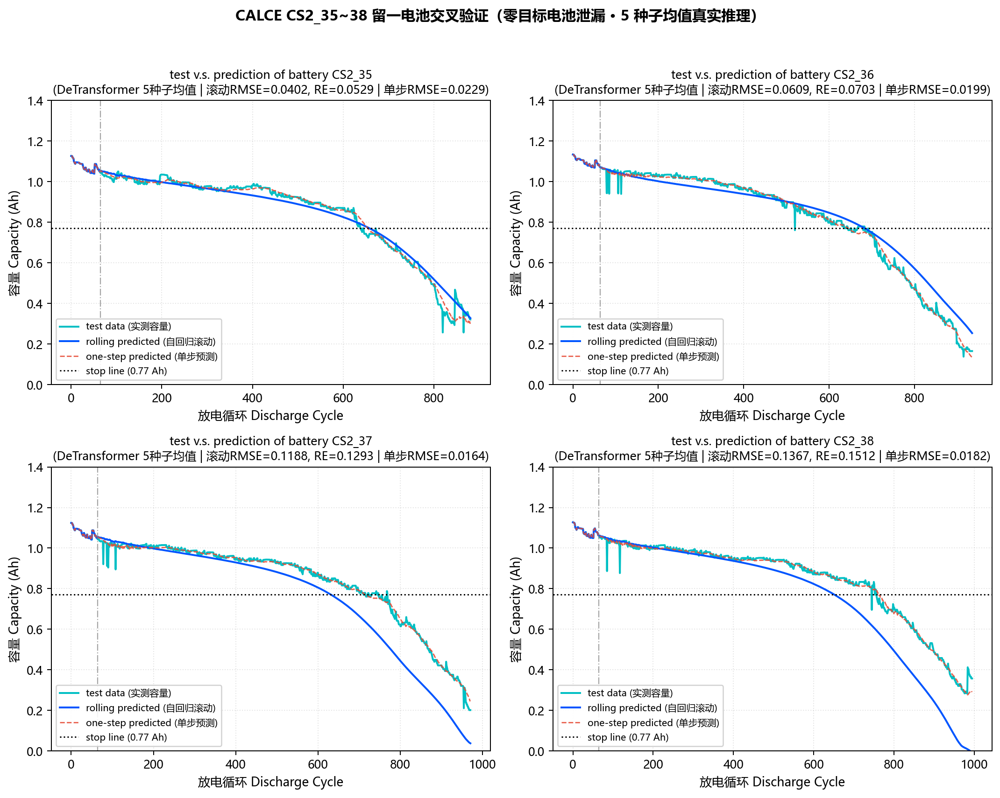
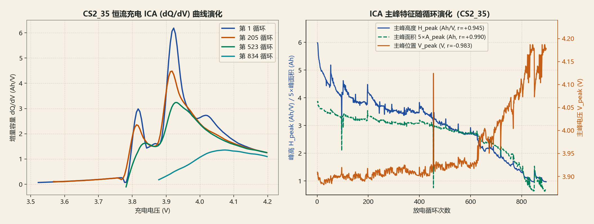

# Battery SOH Assessment System

> Lithium-ion battery state-of-health assessment and degradation analysis

Language: [中文 README](README.md) · English

> [!IMPORTANT]
> This project is a Research Preview for teaching, research, and offline algorithm validation. The strict zero-shot benchmark shows stable one-step capacity fitting, while recursive RUL extrapolation error on vanilla RNN remains large. Results must not be used directly for BMS safety protection, warranty, retirement, or any other safety-critical decision. TCP real-time ingestion is experimental; do not expose it to untrusted networks.

## Evaluation Protocol (Read First)

This section explains how metrics are produced and which numbers to trust. **Evaluation and deployment share the same fitting implementation** (`core/protocol.py::fit_final`), so reported model behavior matches the exported model.

### Outer loop: leave-one-battery-out (LOBO)

Each target battery forms one fold. It contributes nothing to fitting, scaler fitting, hyperparameter selection, or seed selection, and is evaluated once after the model is frozen. Scalers are fitted on training batteries only.

### Refit on all training windows (no target leakage)

An earlier implementation split every training battery into "first 80% train + last 20% validate". Because the end-of-life knee falls in the last 20%, models never saw end-of-life during training yet were asked to predict when capacity crosses the failure threshold. Now evaluation and deployment share `core/protocol.py::fit_final`, training on **every window of every training battery**.

- The default UI evaluation loop (`core/train.py`) fits directly with the configured hyperparameters (skipping inner CV and α shrinkage, aligned with the original project and `XiuzeZhou/RUL`);
- For rolling-origin protocol evaluation and persistence-blend calibration, `core/protocol.py` also provides inner LOBO cross-validation (`select_hparams`) and multi-step rollout calibration (`choose_blend_by_rollout`), reproducible via `python tools/repro_synthetic.py`.

### Prediction modes and metric semantics (one-step vs. recursive)

**The UI defaults to one-step prediction; RUL / RE use recursive extrapolation; benchmarks report both** (`core/train.py::evaluate_prediction_protocols`):

- **One-step prediction (`prediction_mode='one_step'`, UI default):** feeds observed history up to each step, yielding stable RMSE / MAE / R² / Pearson capacity-fit metrics consistent with the original project and `XiuzeZhou/RUL`. Users may switch `prediction_mode` to `rolling` in configuration;
- **Recursive prediction (`recursive` / `rolling`):** provides only the initial measured window and feeds the model's own predictions back into subsequent windows to measure error accumulation; **RUL and failure relative error (RE) are always computed from recursive future rollout** (`rul_protocol='recursive_future'`), never from one-step predictions;
- **Rolling-origin helper (`core/protocol.py::rolling_origin_eval`):** supports multi-origin recursive evaluation at 40% / 50% / 60% / 70% of battery life for benchmark comparisons and protocol studies.

### Baselines: a model must beat them first

`core/baselines.py` and `ui/result_model.py` list three empirical baselines alongside the model: **persistence** (next cycle = last cycle), **linear extrapolation**, and the **double exponential** `C(k)=a·e^{bk}+c·e^{dk}`.

Skill = `1 − RMSE_model / RMSE_persistence`. Cells below 0.05 show ⚠ and a "model did not beat the persistence baseline" note.

### Persistence blend coefficient α (optional rolling-protocol mechanism)

In the rolling-origin protocol (`core/protocol.py::choose_blend_by_rollout`), α ∈ `[0, 1]` shrinks predictions toward the last observed capacity using **multi-step rollout** error on inner-fold models that never saw the validation battery, avoiding the "fit on one step, use on many" collapse (the default UI path in `core/train.py` fixes `persistence_blend=1.0`).

> In synthetic data (`tools/repro_synthetic.py`), the earlier one-step calibration produced α = `0.000` in 4/4 folds (discarding the model entirely); after switching to multi-step rollout calibration, α lands at 0.72–0.80.

### Metrics and failure semantics

- RMSE / MAE / R² / Pearson guard against short, non-finite, or constant input.
- **Right-censoring is explicit:** `observed` / `observed_censored` / `prediction_censored` / `both_censored` / `observed_initial_failure` / `prediction_initial_failure`. The UI shows `N/A（截尾）` rather than pretending a missing crossing is 0 or −1.
- **RUL** is the number of cycles from the prediction origin to EOL — true remaining life, not the legacy bug "how many cycles for SOH to fall from pct% to a threshold (e.g., historical 80%)".
- **SOH** is always defined as `C / C_rated`.
- **Single source of failure logic** (`core/result_semantics.py`): `core/protocol.py`, `core/evaluate.py`, and `ui/result_model.py` all delegate to it.
- **Optional failure debounce** (`TrainConfig.eol_debounce`, default `1`): setting it to `3` requires 3 consecutive cycles below the threshold while still returning the first crossing index.
- **Chunked 2σ outlier cleaning by default (`outlier_mode='chunked'`):** both `config.json` and `TrainConfig` default to `chunked` (40-cycle bins removing points outside `μ ± 2σ` while protecting persistent degradation knees). `mark` (optional; causal 40-cycle window marking without deletion — also the direct-call signature default in `core/adapters.py` and `core/dataload.py`), `delete` (optional; causal removal), and `off` (optional; `NaN`/`Inf` removal only) are kept as selectable modes, with full audit details stored in `frame.attrs['outlier_audit']`.

### Uncertainty: n is the number of batteries, not seeds

- The multi-seed 95% CI reflects only **within-fold seed variation**. It is narrow and does **not** represent generalization uncertainty.
- Real uncertainty comes from "what if this were a different battery", so the cross-battery summary reports mean ± std and a **bootstrap interval** with `n = number of batteries`. With only 4–5 batteries the interval is wide — that is the honest answer.

### Reproduce the comparison

```powershell
python tools/repro_synthetic.py
```

This reproduces the four-way "current flow vs proposed flow" comparison on synthetic NASA-style batteries, printing α, per-origin RMSE, and EOL detection. The data is synthetic and validates the *mechanism* only; replace `make_battery` with your real `battery_dict` for a real comparison.

### Limitations

- No real BMS, CAN, HIL, or bench data was involved; software test evidence cannot substitute for safety certification.
- Good one-step capacity fitting does **not** imply reliable recursive RUL extrapolation.
- Extrapolating to an extreme battery absent from the training set remains hard; the protocol fix is not a cure-all.
- In multi-feature recursive forecasting, non-capacity channels are held at their last observed value (a conservative assumption when future operating conditions are unknown).

### Quality gates

```powershell
python tools/check_undefined.py core models ui utils theme_tokens.py battery_soh_app.py  # used-but-never-defined globals
python tools/check_colors.py                                                             # colour literals only in theme_tokens.py
python tools/sync_readme_defaults.py --check                                             # verify README defaults match code/config.json
python -m unittest discover -s tests                                                     # regression tests
```

## Default Parameters & Code Locations

The table below summarizes the active runtime defaults (`config.json`, loaded by the UI on startup) alongside `TrainConfig` class defaults (`utils/config.py`), noting any signature or historical differences:

<!-- DEFAULTS:BEGIN -->
> Auto-generated from `config.json` and `utils/config.py::TrainConfig` via `python tools/sync_readme_defaults.py` (`--check` enforced in CI).

| Parameter | Runtime Default (`config.json` / UI) | `TrainConfig` Default | Notes & Code Location |
|---|---|---|---|
| `rated_capacity` | `1.1` | `1.1` | Rated capacity (Ah) (`config.json`, `utils/config.py`) |
| `threshold_ratio` | `0.7` | `0.8` | Failure threshold ratio (UI loads `0.7` from `config.json`; `TrainConfig` / persistence fallback and historical `5681172` benchmark use `0.8`) (`config.json`, `utils/config.py`, `ui/main_window.py`) |
| `voltage_upper` | `3.8` | `3.8` | Upper voltage for `dq_v` (V) (`config.json`, `utils/config.py`) |
| `voltage_lower` | `3.4` | `3.4` | Lower voltage for `dq_v` (V) (`config.json`, `utils/config.py`) |
| `window_size` | `64` | `64` | Sliding input window length (cycles) (`config.json`, `utils/config.py`) |
| `epochs` | `100` | `100` | Deep-learning training epochs (`config.json`, `utils/config.py`) |
| `hidden_dim` | `64` | `64` | Hidden dimension for RNN / DeTransformer (`config.json`, `utils/config.py`) |
| `mode` | `RNN` | `RNN` | Default evaluation model (`config.json`, `utils/config.py`) |
| `metric` | `all` | `rmse` | Default display metric (`all` in `config.json`; `rmse` on `TrainConfig`) (`config.json`, `utils/config.py`) |
| `device` | `cpu` | `cpu` | Default compute device (`cpu` / `cuda`) (`config.json`, `utils/config.py`) |
| `seed` | `2` | `2` | Base random seed (`config.json`, `utils/config.py`) |
| `n_seeds` | `1` | `5` | Number of random seeds (UI loads `1` from `config.json`; `TrainConfig` defaults to `5`; benchmarks use `5`) (`config.json`, `utils/config.py`) |
| `patience` | `20` | `20` | XGBoost early-stopping rounds (`config.json`, `utils/config.py`) |
| `norm_method` | `rated` | `rated` | Capacity scaling method (`rated` / `minmax` / `zscore`) (`config.json`, `utils/config.py`) |
| `n_estimators` | `100` | `100` | Number of trees (XGBoost / RF) (`config.json`, `utils/config.py`) |
| `learning_rate` | `0.1` | `0.1` | XGBoost learning rate (`config.json`, `utils/config.py`) |
| `max_depth` | `6` | `6` | Maximum tree depth (XGBoost / RF) (`config.json`, `utils/config.py`) |
| `subsample` | `1.0` | `1.0` | XGBoost row subsample ratio (`config.json`, `utils/config.py`) |
| `colsample_bytree` | `1.0` | `1.0` | XGBoost column subsample ratio (`config.json`, `utils/config.py`) |
| `min_samples_leaf` | `1` | `1` | RF minimum samples per leaf (`config.json`, `utils/config.py`) |
| `max_features` | `1.0` | `1.0` | RF max features ratio (`config.json`, `utils/config.py`) |
| `rnn_lr` | `0.001` *(via `TrainConfig`)* | `0.001` | Deep-learning Adam learning rate (`TrainConfig` only) (`utils/config.py`) |
| `rnn_dropout` | `0.1` *(via `TrainConfig`)* | `0.1` | Deep-learning dropout rate (`TrainConfig` only) (`utils/config.py`) |
| `feature_columns` | `['capacity']` | `['capacity']` | Input feature columns (capacity-only autoregression by default) (`config.json`, `utils/config.py`) |
| `eol_debounce` | `1` *(via `TrainConfig`)* | `1` | Consecutive cycles below threshold for EOL confirmation (`TrainConfig` / `core/result_semantics.py`) (`utils/config.py`, `core/result_semantics.py`) |
| `adapter_type` | `CALCE` | `CALCE` | Default data adapter (`CALCE` / `NASA`) (`config.json`, `utils/config.py`) |
| `cc_step` | `2` | `None` | CALCE constant-current charge step index (`config.json`, `utils/config.py`) |
| `cv_step` | `4` | `None` | CALCE constant-voltage charge step index (`config.json`, `utils/config.py`) |
| `discharge_step` | `7` | `None` | CALCE discharge step index (`config.json`, `utils/config.py`) |
| `outlier_mode` | `chunked` | `chunked` | Outlier handling: UI/evaluation runtime passes `chunked` via `TrainConfig` and `ui/worker.py`; direct calls to `adapters.py`/`dataload.py` default to `mark` in function signatures (`config.json`, `utils/config.py`, `ui/worker.py`, `core/adapters.py`) |
| `backbone` | `default` | `default` | Neural backbone (`default` / `Transformer` / `DeTransformer`) (`config.json`, `utils/config.py`, `core/model_factory.py`) |
| `num_layers` | `1` | `1` | Number of recurrent / Transformer layers (`config.json`, `utils/config.py`) |
| `nhead` | `1` | `1` | Number of Transformer attention heads (`config.json`, `utils/config.py`) |
| `transformer_k` | `16` | `16` | DeTransformer univariate channel replication factor K (`config.json`, `utils/config.py`) |
| `alpha` | `0.1` | `0.1` | DeTransformer autoencoder reconstruction loss weight α (`config.json`, `utils/config.py`) |
| `noise_level` | `0.0` | `0.0` | DeTransformer autoencoder input noise level (`config.json`, `utils/config.py`) |
| `weight_decay` | `0.0` | `0.0` | Deep-learning Adam weight decay (`config.json`, `utils/config.py`) |
| `prediction_mode` | `one_step` | `one_step` | UI headline prediction mode: `one_step` (one-step fit metrics + recursive RUL/RE); optional `rolling` (`config.json`, `utils/config.py`, `core/train.py`) |

> **Note on `outlier_mode` runtime resolution**: `config.json` and `TrainConfig` default to `chunked`, and `ui/worker.py` passes `config.outlier_mode` (`chunked`) at runtime. Function signatures in `core/dataload.py` (`mark`), `core/adapters.py::CALCEAdapter` (`mark`), and `core/adapters.py::NASAAdapter` (`mark`) keep `mark` as their direct-call default.
<!-- DEFAULTS:END -->

## Strict Zero-Shot Benchmark

The benchmark uses strict zero-shot leave-one-battery-out evaluation: the target battery is excluded from training, scaling, hyperparameter tuning, and seed selection. Both **one-step prediction** (matching the UI default) and **rolling-origin recursive extrapolation** (at 40% / 50% / 60% / 70% of life, with skill vs. persistence flagged ⚠ when `< 0.05`) are reported alongside full-horizon recursive RUL / RE and explicit censoring states. All preselected seeds are included in every mean.

Re-run via `python scripts/run_strict_benchmark.py --n-seeds 5` (writes `benchmark/results_<short_commit>.json`, rendered below via `python tools/render_benchmark_table.py`).

<!-- BENCH:BEGIN -->
> Source: [`benchmark/results_cbcbfa9.json`](benchmark/results_cbcbfa9.json) · Commit: `cbcbfa9` · Protocol: `strict_zero_shot_leave_one_battery_out` · `threshold_ratio=0.7` · `outlier_mode=chunked`

### Macro Summary (6 Models + 3 Baselines, CALCE `CS2_35`–`CS2_38` LOBO, 5-Seed Mean)

| Model / Baseline | 1-Step RMSE ↓ | 1-Step MAE ↓ | 1-Step R² ↑ | 40% Roll RMSE | 50% Roll RMSE | 60% Roll RMSE | 70% Roll RMSE | Mean Skill ↑ | Rec. RE ↓ |
|---|---:|---:|---:|---:|---:|---:|---:|---:|---:|
| **RNN** | 0.0205 | 0.0152 | 0.9916 | 0.2796 | 0.3115 | 0.3479 | 0.3948 | +0.028 ⚠ | 43.46% |
| **GRU** | 0.0820 | 0.0618 | 0.8700 | 0.2745 | 0.2976 | 0.3316 | 0.3819 | +0.061 | — |
| **LSTM** | 0.1036 | 0.0767 | 0.8040 | 0.2681 | 0.2897 | 0.3223 | 0.3715 | +0.086 | — |
| **XGBoost** | 0.0148 | 0.0084 | 0.9959 | 0.2813 | 0.1942 | 0.1085 | 0.1289 | +0.483 | — |
| **RF** | 0.0139 | 0.0074 | 0.9965 | 0.3428 | 0.3520 | 0.3173 | 0.3169 | +0.033 ⚠ | — |
| **DeTransformer** | 0.0191 | 0.0121 | 0.9931 | 0.1234 | 0.0929 | 0.0662 | 0.0595 | +0.752 | 17.79% |
| Persistence | 0.0132 | 0.0050 | 0.9969 | 0.3478 | 0.3554 | 0.3363 | 0.3329 | +0.000 (base) | — |
| Linear Extrap. | 0.0132 | 0.0049 | 0.9969 | 0.3272 | 0.2339 | 0.1435 | 0.1889 | +0.352 | 24.78% |
| Double Exp. | — | — | — | 0.2822 | 0.2680 | 0.2291 | 0.1634 | +0.312 | — |

#### Per-Origin Skill vs. Persistence (`1 − RMSE_model / RMSE_persistence`; `< 0.05` flagged ⚠)

| Model / Baseline | 40% Origin | 50% Origin | 60% Origin | 70% Origin | Macro Skill |
|---|---:|---:|---:|---:|---:|
| **RNN** | +0.199 | +0.127 | -0.031 ⚠ | -0.184 ⚠ | +0.028 ⚠ |
| **GRU** | +0.210 | +0.164 | +0.016 ⚠ | -0.145 ⚠ | +0.061 |
| **LSTM** | +0.229 | +0.187 | +0.044 ⚠ | -0.114 ⚠ | +0.086 |
| **XGBoost** | +0.206 | +0.445 | +0.675 | +0.605 | +0.483 |
| **RF** | +0.016 ⚠ | +0.009 ⚠ | +0.057 | +0.050 ⚠ | +0.033 ⚠ |
| **DeTransformer** | +0.655 | +0.735 | +0.800 | +0.816 | +0.752 |
| Linear Extrap. | +0.054 | +0.343 | +0.571 | +0.438 | +0.352 |
| Double Exp. | +0.193 | +0.237 | +0.311 | +0.509 | +0.312 |

<details>
<summary>Expand per-(model × battery) details (1-step metrics, 40%–70% rolling RMSE/skill, EOL, RE & censoring)</summary>

| Model | Battery | Cycles | 1-Step RMSE | 1-Step MAE | 1-Step R² | 40% RMSE (Skill) | 50% RMSE (Skill) | 60% RMSE (Skill) | 70% RMSE (Skill) | Pred EOL | True EOL | Rec. RE | Status |
|---|---|---:|---:|---:|---:|---|---|---|---|---:|---:|---:|---|
| RNN | CS2_35 | 896 | 0.0205 ± 0.0069 | 0.0146 ± 0.0070 | 0.9900 ± 0.0072 | 0.2479 (+0.225) | 0.2750 (+0.161) | 0.3085 (+0.052) | 0.3519 (-0.142 ⚠) | 449 | 641 | 33.33% ± 0.00% | mixed |
| RNN | CS2_36 | 941 | 0.0222 ± 0.0059 | 0.0167 ± 0.0058 | 0.9926 ± 0.0041 | 0.3412 (+0.164) | 0.3731 (+0.039 ⚠) | 0.4135 (-0.144 ⚠) | 0.4625 (-0.303 ⚠) | N/A（截尾） | 517 | — | prediction_censored |
| RNN | CS2_37 | 1008 | 0.0204 ± 0.0058 | 0.0153 ± 0.0051 | 0.9921 ± 0.0045 | 0.2853 (+0.176) | 0.3181 (+0.127) | 0.3557 (-0.049 ⚠) | 0.4017 (-0.213 ⚠) | 388 | 715 | 50.31% ± 0.00% | mixed |
| RNN | CS2_38 | 1038 | 0.0190 ± 0.0070 | 0.0141 ± 0.0068 | 0.9918 ± 0.0065 | 0.2441 (+0.230) | 0.2799 (+0.180) | 0.3140 (+0.016 ⚠) | 0.3633 (-0.077 ⚠) | 431 | 752 | 46.72% ± 0.00% | mixed |
| GRU | CS2_35 | 896 | 0.0688 ± 0.0226 | 0.0529 ± 0.0185 | 0.8882 ± 0.0633 | 0.2457 (+0.232) | 0.2645 (+0.193) | 0.2939 (+0.097) | 0.3390 (-0.100 ⚠) | N/A（截尾） | 641 | — | prediction_censored |
| GRU | CS2_36 | 941 | 0.1039 ± 0.0255 | 0.0792 ± 0.0196 | 0.8401 ± 0.0725 | 0.3126 (+0.234) | 0.3398 (+0.125) | 0.3794 (-0.050 ⚠) | 0.4363 (-0.229 ⚠) | N/A（截尾） | 517 | — | prediction_censored |
| GRU | CS2_37 | 1008 | 0.0840 ± 0.0236 | 0.0614 ± 0.0178 | 0.8659 ± 0.0676 | 0.2830 (+0.182) | 0.3078 (+0.155) | 0.3430 (-0.012 ⚠) | 0.3950 (-0.193 ⚠) | N/A（截尾） | 715 | — | prediction_censored |
| GRU | CS2_38 | 1038 | 0.0714 ± 0.0230 | 0.0536 ± 0.0179 | 0.8859 ± 0.0638 | 0.2567 (+0.191) | 0.2783 (+0.184) | 0.3099 (+0.029 ⚠) | 0.3574 (-0.059 ⚠) | N/A（截尾） | 752 | — | prediction_censored |
| LSTM | CS2_35 | 896 | 0.0860 ± 0.0109 | 0.0649 ± 0.0121 | 0.8372 ± 0.0394 | 0.2392 (+0.252) | 0.2561 (+0.218) | 0.2839 (+0.128) | 0.3275 (-0.062 ⚠) | N/A（截尾） | 641 | — | prediction_censored |
| LSTM | CS2_36 | 941 | 0.1321 ± 0.0104 | 0.0996 ± 0.0066 | 0.7518 ± 0.0401 | 0.3067 (+0.249) | 0.3327 (+0.143) | 0.3714 (-0.028 ⚠) | 0.4274 (-0.204 ⚠) | N/A（截尾） | 517 | — | prediction_censored |
| LSTM | CS2_37 | 1008 | 0.1068 ± 0.0104 | 0.0764 ± 0.0082 | 0.7950 ± 0.0397 | 0.2764 (+0.202) | 0.2998 (+0.177) | 0.3338 (+0.015 ⚠) | 0.3847 (-0.162 ⚠) | N/A（截尾） | 715 | — | prediction_censored |
| LSTM | CS2_38 | 1038 | 0.0896 ± 0.0111 | 0.0659 ± 0.0111 | 0.8320 ± 0.0398 | 0.2500 (+0.212) | 0.2700 (+0.209) | 0.3001 (+0.060) | 0.3462 (-0.026 ⚠) | N/A（截尾） | 752 | — | prediction_censored |
| XGBoost | CS2_35 | 896 | 0.0161 ± 0.0000 | 0.0093 ± 0.0000 | 0.9944 ± 0.0000 | 0.3038 (+0.050 ⚠) | 0.3328 (-0.016 ⚠) | 0.1948 (+0.402) | 0.2091 (+0.322) | N/A（截尾） | 641 | — | prediction_censored |
| XGBoost | CS2_36 | 941 | 0.0160 ± 0.0000 | 0.0092 ± 0.0000 | 0.9964 ± 0.0000 | 0.3866 (+0.053) | 0.2069 (+0.467) | 0.0739 (+0.796) | 0.0837 (+0.764) | N/A（截尾） | 517 | — | prediction_censored |
| XGBoost | CS2_37 | 1008 | 0.0125 ± 0.0000 | 0.0067 ± 0.0000 | 0.9972 ± 0.0000 | 0.3454 (+0.002 ⚠) | 0.1255 (+0.655) | 0.1129 (+0.667) | 0.1179 (+0.644) | N/A（截尾） | 715 | — | prediction_censored |
| XGBoost | CS2_38 | 1038 | 0.0145 ± 0.0000 | 0.0084 ± 0.0000 | 0.9956 ± 0.0000 | 0.0893 (+0.719) | 0.1116 (+0.673) | 0.0525 (+0.836) | 0.1048 (+0.689) | N/A（截尾） | 752 | — | prediction_censored |
| RF | CS2_35 | 896 | 0.0136 ± 0.0002 | 0.0071 ± 0.0002 | 0.9960 ± 0.0001 | 0.3052 (+0.045 ⚠) | 0.3344 (-0.020 ⚠) | 0.2801 (+0.139) | 0.2773 (+0.100) | N/A（截尾） | 641 | — | prediction_censored |
| RF | CS2_36 | 941 | 0.0164 ± 0.0002 | 0.0089 ± 0.0001 | 0.9962 ± 0.0001 | 0.4080 (+0.001 ⚠) | 0.3858 (+0.006 ⚠) | 0.3397 (+0.060) | 0.3537 (+0.003 ⚠) | N/A（截尾） | 517 | — | prediction_censored |
| RF | CS2_37 | 1008 | 0.0125 ± 0.0001 | 0.0065 ± 0.0001 | 0.9972 ± 0.0000 | 0.3449 (+0.004 ⚠) | 0.3476 (+0.046 ⚠) | 0.3352 (+0.011 ⚠) | 0.3252 (+0.018 ⚠) | N/A（截尾） | 715 | — | prediction_censored |
| RF | CS2_38 | 1038 | 0.0130 ± 0.0001 | 0.0071 ± 0.0001 | 0.9965 ± 0.0001 | 0.3130 (+0.013 ⚠) | 0.3403 (+0.003 ⚠) | 0.3142 (+0.016 ⚠) | 0.3114 (+0.077) | N/A（截尾） | 752 | — | prediction_censored |
| DeTransformer | CS2_35 | 896 | 0.0218 ± 0.0008 | 0.0138 ± 0.0005 | 0.9896 ± 0.0008 | 0.0676 (+0.788) | 0.1637 (+0.500) | 0.0871 (+0.733) | 0.1154 (+0.626) | 686.4 | 641 | 7.88% ± 3.16% | observed |
| DeTransformer | CS2_36 | 941 | 0.0196 ± 0.0006 | 0.0128 ± 0.0006 | 0.9946 ± 0.0003 | 0.2229 (+0.454) | 0.1132 (+0.709) | 0.0444 (+0.877) | 0.0379 (+0.893) | 705.8 | 517 | 41.77% ± 1.36% | observed |
| DeTransformer | CS2_37 | 1008 | 0.0169 ± 0.0007 | 0.0107 ± 0.0006 | 0.9949 ± 0.0004 | 0.0728 (+0.790) | 0.0376 (+0.897) | 0.0564 (+0.833) | 0.0429 (+0.870) | 659.8 | 715 | 8.49% ± 2.46% | observed |
| DeTransformer | CS2_38 | 1038 | 0.0179 ± 0.0004 | 0.0110 ± 0.0004 | 0.9934 ± 0.0003 | 0.1304 (+0.589) | 0.0569 (+0.833) | 0.0771 (+0.758) | 0.0416 (+0.877) | 693 | 752 | 13.01% ± 3.54% | observed |
| Persistence | CS2_35 | 896 | 0.0121 | 0.0046 | 0.9968 | 0.3197 (+0.000 (base)) | 0.3277 (+0.000 (base)) | 0.3254 (+0.000 (base)) | 0.3083 (+0.000 (base)) | N/A（截尾） | 641 | — | prediction_censored |
| Persistence | CS2_36 | 941 | 0.0159 | 0.0060 | 0.9964 | 0.4082 (+0.000 (base)) | 0.3883 (+0.000 (base)) | 0.3615 (+0.000 (base)) | 0.3549 (+0.000 (base)) | N/A（截尾） | 517 | — | prediction_censored |
| Persistence | CS2_37 | 1008 | 0.0132 | 0.0050 | 0.9969 | 0.3462 (+0.000 (base)) | 0.3642 (+0.000 (base)) | 0.3389 (+0.000 (base)) | 0.3311 (+0.000 (base)) | N/A（截尾） | 715 | — | prediction_censored |
| Persistence | CS2_38 | 1038 | 0.0115 | 0.0045 | 0.9972 | 0.3172 (+0.000 (base)) | 0.3412 (+0.000 (base)) | 0.3192 (+0.000 (base)) | 0.3374 (+0.000 (base)) | N/A（截尾） | 752 | — | prediction_censored |
| Linear Extrap. | CS2_35 | 896 | 0.0121 | 0.0044 | 0.9968 | 0.3988 (-0.247 ⚠) | 0.1133 (+0.654) | 0.1978 (+0.392) | 0.0953 (+0.691) | 471 | 641 | 29.51% | observed |
| Linear Extrap. | CS2_36 | 941 | 0.0158 | 0.0059 | 0.9964 | 0.3601 (+0.118) | 0.2024 (+0.479) | 0.1529 (+0.577) | 0.1947 (+0.451) | 603 | 517 | 19.03% | observed |
| Linear Extrap. | CS2_37 | 1008 | 0.0132 | 0.0049 | 0.9969 | 0.2933 (+0.153) | 0.3088 (+0.152) | 0.0871 (+0.743) | 0.1579 (+0.523) | 460 | 715 | 39.23% | observed |
| Linear Extrap. | CS2_38 | 1038 | 0.0115 | 0.0044 | 0.9972 | 0.2565 (+0.191) | 0.3111 (+0.088) | 0.1364 (+0.573) | 0.3078 (+0.088) | 830 | 752 | 11.35% | observed |
| Double Exp. | CS2_35 | 896 | — | — | — | 0.2459 (+0.231) | 0.2993 (+0.087) | 0.3011 (+0.075) | 0.1033 (+0.665) | N/A（截尾） | 641 | — | prediction_censored |
| Double Exp. | CS2_36 | 941 | — | — | — | 0.3515 (+0.139) | 0.1899 (+0.511) | 0.2101 (+0.419) | 0.0410 (+0.884) | N/A（截尾） | 517 | — | prediction_censored |
| Double Exp. | CS2_37 | 1008 | — | — | — | 0.2883 (+0.167) | 0.3057 (+0.161) | 0.1140 (+0.664) | 0.0574 (+0.827) | N/A（截尾） | 715 | — | prediction_censored |
| Double Exp. | CS2_38 | 1038 | — | — | — | 0.2433 (+0.233) | 0.2772 (+0.188) | 0.2913 (+0.087) | 0.4520 (-0.340 ⚠) | N/A（截尾） | 752 | — | prediction_censored |

</details>

Reproducibility metadata & dataset hashes:

- Source commit: `cbcbfa949065a74d284475544bb0d79e22a36f8b`
- Elapsed seconds: 3363.00 s
- Hardware: AMD64 Family 25 Model 117 Stepping 2, AuthenticAMD; GPU: NVIDIA GeForce RTX 4050 Laptop GPU; Driver: 616.64; CUDA: 13.0
- Software: PyQt6 6.11.0; numpy 1.26.4; pandas 2.3.3; matplotlib 3.10.9; torch 2.13.0+cu130; scikit-learn 1.7.2; xgboost 3.0.2; scipy 1.15.3; joblib 1.5.3; openpyxl 3.1.5

| Battery | Cycles | Source SHA-256 | Cleaned Capacity SHA-256 |
|---|---:|---|---|
| CS2_35 | 896 | `dfeda906c01c37161cc569fdc41c11e0aed00f675c32c4a000fa845791d810f8` | `811bf49f66363ca9ca30af570ba87a6dc39bdf9158913780d02274467ee94a85` |
| CS2_36 | 941 | `bee2c8e094f05feed6c53bab3ba930ca9580e436e41431ddd3b17e905a99aa4a` | `4e649c53b89bf545d6a284fb8cce05f0feff8b3e8e5a24e27093cce20a9e83bb` |
| CS2_37 | 1008 | `dacc6cf5cd04e147afac28051917564ab204bce48810919a896e8e85cfb4e5ee` | `c123db2c3db2664e01b2563a419b1e041426867bfbbac84ad1097b0ca1367960` |
| CS2_38 | 1038 | `39ed8e425eb5155835d08e3aadaf588ef4321f57f2d7e5eabb19e1e41f956760` | `8c91320c5a75e1760f5a6d66d631e67615d43cf1cad0a80ddb18d5e24a8fc423` |
<!-- BENCH:END -->

### Honest Takeaways

1. **Who beats persistence:** Under strict zero-shot LOBO evaluation, only **`DeTransformer`** (`+0.752` macro skill) and **`XGBoost`** (`+0.483`) consistently outperform all three empirical baselines (linear extrapolation `+0.352`, double-exponential `+0.312`, persistence `0.000`). `RF` (`+0.033 ⚠`) and vanilla `RNN` (`+0.028 ⚠`) fall below the `0.05` threshold, while `GRU` (`+0.061`) and `LSTM` (`+0.086`) drop behind persistence from the 60%–70% origins onward.
2. **Where recursive rollout becomes usable:** `DeTransformer` already provides strong recursive skill at the 40% origin (`0.1234` RMSE, `+0.655` skill) and improves to `0.0595`–`0.0662` RMSE (`+0.800`–`+0.816` skill) at the **60%–70% origins**, reaching a `17.79%` macro recursive RE. `XGBoost` is competitive from the **60% origin onward** (`+0.605`–`+0.675` skill), though early-origin tree rollouts often saturate and become `prediction_censored`.
3. **What cannot be claimed:** **Strong one-step R² does not imply reliable RUL extrapolation** — persistence itself achieves `0.9969` one-step R² (`0.0132` RMSE), and `RF` (`0.9965` 1-step R²) / `RNN` (`0.9916` 1-step R²) break down under multi-step recursion. Furthermore, these numbers cover only four same-chemistry CALCE cells (and `CS2_36`'s noisy early dip at cycle 517 inflates non-debounced EOL RE), so they cannot justify cross-chemistry generalization or BMS safety deployment.



<details>
<summary>Historical Baseline (commit <code>5681172</code>, for traceability)</summary>

The table below is the **historical benchmark** generated at source commit `5681172` (historical parameters used `threshold_ratio=0.8` and chunked outlier cleaning across 3,883 CALCE CS2_35–38 cycles; current `config.json` defaults to `threshold_ratio=0.7`). Machine-readable details are preserved in [`benchmark/strict_zero_shot_rnn.json`](benchmark/strict_zero_shot_rnn.json) (`python scripts/run_strict_benchmark.py --legacy-rnn`):

| Battery | Cycles | RMSE ↓ (Ah) | MAE ↓ (Ah) | R² ↑ | Pearson ↑ | Recursive RE ↓ | RE status |
|---------|-------:|------------:|-----------:|-----:|----------:|----------------:|-----------|
| CS2_35 | 896 | 0.0340 | 0.0300 | 0.9737 | 0.9981 | 97.69% | observed |
| CS2_36 | 941 | 0.0381 | 0.0329 | 0.9780 | 0.9984 | 97.53% | observed |
| CS2_37 | 1,008 | 0.0383 | 0.0340 | 0.9720 | 0.9986 | 97.46% | observed |
| CS2_38 | 1,038 | 0.0375 | 0.0331 | 0.9684 | 0.9984 | 97.32% | observed |
| **Macro average** | **970.8** | **0.0370** | **0.0325** | **0.9730** | **0.9984** | **97.50%** | — |

> Note: an earlier `DeTransformer` alignment table used pre-extracted `CALCE.npy` (3,786 cycles; 5-seed rolling RMSE `0.0892 ± 0.0186`, 1-step RMSE `0.0194 ± 0.0014`). The new benchmark above evaluates all 6 models and 3 baselines on the exact same raw `CS2_35`–`CS2_38` dataset (3,883 cycles).

</details>

## Generalization Validation (NASA PCoE)

Using the official NASA PCoE battery dataset (`B0005`, `B0006`, `B0007`, `B0018`; `rated_capacity=2.0 Ah`, `threshold_ratio=0.7` or `1.40 Ah`, downloaded and SHA-256 verified via `python tools/fetch_nasa.py`), we run two dedicated generalization checks under [`scripts/run_strict_benchmark.py`](scripts/run_strict_benchmark.py):

<!-- NASA:BEGIN -->
> Source: [`benchmark/nasa_6759ba3.json`](benchmark/nasa_6759ba3.json) · Commit: `6759ba3` · NASA `rated_capacity=2.0 Ah` · `threshold_ratio=0.7` (1.40 Ah) · `outlier_mode=chunked`

### Experiment A (In-Domain): NASA 4-Cell LOBO (`B0005`/`B0006`/`B0007`/`B0018`, 5-Seed Mean)

| Model / Baseline | 1-Step RMSE ↓ | 1-Step MAE ↓ | 1-Step R² ↑ | 40% Roll RMSE | 50% Roll RMSE | 60% Roll RMSE | 70% Roll RMSE | Mean Skill ↑ | Rec. RE ↓ |
|---|---:|---:|---:|---:|---:|---:|---:|---:|---:|
| **RNN** | 0.0924 | 0.0774 | -0.2332 | 0.1299 | 0.1030 | 0.1008 | 0.1054 | +0.141 | — |
| **GRU** | 0.0759 | 0.0638 | 0.1559 | 0.1266 | 0.0989 | 0.0959 | 0.0997 | +0.182 | — |
| **LSTM** | 0.0873 | 0.0730 | -0.0817 | 0.1275 | 0.1029 | 0.1024 | 0.1072 | +0.134 | — |
| **XGBoost** | 0.0308 | 0.0232 | 0.8511 | 0.1154 | 0.0542 | 0.0476 | 0.0502 | +0.485 | 65.77% |
| **RF** | 0.0255 | 0.0184 | 0.8914 | 0.1045 | 0.0501 | 0.0490 | 0.0457 | +0.519 | 83.73% |
| **DeTransformer** | 0.0367 | 0.0328 | 0.7521 | 0.0813 | 0.0609 | 0.0542 | 0.0496 | +0.506 | 42.73% |
| Persistence | 0.0136 | 0.0090 | 0.9539 | 0.2121 | 0.1462 | 0.1108 | 0.0805 | +0.000 (base) | — |
| Linear Extrap. | 0.0132 | 0.0071 | 0.9550 | 0.1130 | 0.1169 | 0.0692 | 0.0411 | +0.339 | 17.86% |
| Double Exp. | — | — | — | 0.0886 | 0.0619 | 0.0417 | 0.0335 | +0.575 | 0.00% |

<details>
<summary>Expand per-(model × battery) details (1-step metrics, 40%–70% rolling RMSE/skill, EOL, RE & censoring)</summary>

| Model | Battery | Cycles | 1-Step RMSE | 1-Step MAE | 1-Step R² | 40% RMSE (Skill) | 50% RMSE (Skill) | 60% RMSE (Skill) | 70% RMSE (Skill) | Pred EOL | True EOL | Rec. RE | Status |
|---|---|---:|---:|---:|---:|---|---|---|---|---:|---:|---:|---|
| RNN | B0005 | 163 | 0.0839 ± 0.0094 | 0.0733 ± 0.0083 | 0.3352 ± 0.1453 | 0.0999 (+0.569) | 0.0859 (+0.498) | 0.0864 (+0.314) | 0.0990 (-0.306 ⚠) | N/A（截尾） | 121 | — | prediction_censored |
| RNN | B0006 | 165 | 0.1221 ± 0.0133 | 0.0979 ± 0.0106 | -0.2094 ± 0.2586 | 0.1478 (+0.344) | 0.1602 (+0.043 ⚠) | 0.1789 (-0.228 ⚠) | 0.2013 (-0.814 ⚠) | N/A（截尾） | 107 | — | prediction_censored |
| RNN | B0007 | 162 | 0.1181 ± 0.0127 | 0.0990 ± 0.0107 | -1.2867 ± 0.4732 | 0.1422 (+0.207) | 0.1130 (+0.098) | 0.0868 (+0.111) | 0.0628 (+0.025 ⚠) | N/A（截尾） | N/A（截尾） | — | both_censored |
| RNN | B0018 | 131 | 0.0455 ± 0.0047 | 0.0393 ± 0.0040 | 0.2283 ± 0.1585 | — | 0.0529 (+0.563) | 0.0513 (+0.305) | 0.0585 (+0.174) | N/A（截尾） | 97 | — | prediction_censored |
| GRU | B0005 | 163 | 0.0682 ± 0.0062 | 0.0592 ± 0.0053 | 0.5621 ± 0.0798 | 0.0952 (+0.590) | 0.0803 (+0.531) | 0.0793 (+0.371) | 0.0907 (-0.197 ⚠) | N/A（截尾） | 121 | — | prediction_censored |
| GRU | B0006 | 165 | 0.0979 ± 0.0081 | 0.0785 ± 0.0065 | 0.2249 ± 0.1275 | 0.1408 (+0.375) | 0.1526 (+0.089) | 0.1703 (-0.170 ⚠) | 0.1913 (-0.724 ⚠) | N/A（截尾） | 107 | — | prediction_censored |
| GRU | B0007 | 162 | 0.1006 ± 0.0092 | 0.0856 ± 0.0080 | -0.6556 ± 0.3042 | 0.1440 (+0.196) | 0.1158 (+0.076) | 0.0896 (+0.083) | 0.0659 (-0.025 ⚠) | 78.5 | N/A（截尾） | — | mixed |
| GRU | B0018 | 131 | 0.0370 ± 0.0027 | 0.0319 ± 0.0023 | 0.4921 ± 0.0728 | — | 0.0471 (+0.612) | 0.0445 (+0.397) | 0.0507 (+0.284) | N/A（截尾） | 97 | — | prediction_censored |
| LSTM | B0005 | 163 | 0.0790 ± 0.0047 | 0.0694 ± 0.0038 | 0.4148 ± 0.0699 | 0.0976 (+0.579) | 0.0875 (+0.488) | 0.0908 (+0.279) | 0.1043 (-0.376 ⚠) | N/A（截尾） | 121 | — | prediction_censored |
| LSTM | B0006 | 165 | 0.1193 ± 0.0047 | 0.0958 ± 0.0037 | -0.1455 ± 0.0912 | 0.1518 (+0.327) | 0.1651 (+0.014 ⚠) | 0.1842 (-0.265 ⚠) | 0.2060 (-0.857 ⚠) | N/A（截尾） | 107 | — | prediction_censored |
| LSTM | B0007 | 162 | 0.1058 ± 0.0111 | 0.0876 ± 0.0105 | -0.8338 ± 0.3932 | 0.1333 (+0.256) | 0.1049 (+0.163) | 0.0787 (+0.194) | 0.0551 (+0.144) | 79 | N/A（截尾） | — | mixed |
| LSTM | B0018 | 131 | 0.0453 ± 0.0018 | 0.0390 ± 0.0015 | 0.2378 ± 0.0616 | — | 0.0542 (+0.553) | 0.0560 (+0.241) | 0.0635 (+0.104) | N/A（截尾） | 97 | — | prediction_censored |
| XGBoost | B0005 | 163 | 0.0200 ± 0.0000 | 0.0136 ± 0.0000 | 0.9627 ± 0.0000 | 0.0902 (+0.611) | 0.0198 (+0.885) | 0.0199 (+0.842) | 0.0282 (+0.628) | 156 | 121 | 62.50% ± 0.00% | observed |
| XGBoost | B0006 | 165 | 0.0481 ± 0.0000 | 0.0334 ± 0.0000 | 0.8143 ± 0.0000 | 0.1482 (+0.342) | 0.0514 (+0.693) | 0.0572 (+0.607) | 0.0608 (+0.452) | 136 | 107 | 69.05% ± 0.00% | observed |
| XGBoost | B0007 | 162 | 0.0314 ± 0.0000 | 0.0274 ± 0.0000 | 0.8400 ± 0.0000 | 0.1079 (+0.398) | 0.0865 (+0.310) | 0.0726 (+0.257) | 0.0709 (-0.101 ⚠) | 117 | N/A（截尾） | — | observed_censored |
| XGBoost | B0018 | 131 | 0.0240 ± 0.0000 | 0.0184 ± 0.0000 | 0.7872 ± 0.0000 | — | 0.0591 (+0.512) | 0.0406 (+0.450) | 0.0411 (+0.419) | N/A（截尾） | 97 | — | prediction_censored |
| RF | B0005 | 163 | 0.0148 ± 0.0003 | 0.0105 ± 0.0003 | 0.9795 ± 0.0008 | 0.0711 (+0.693) | 0.0222 (+0.870) | 0.0288 (+0.771) | 0.0195 (+0.742) | 154 | 121 | 58.93% ± 10.02% | observed |
| RF | B0006 | 165 | 0.0462 ± 0.0002 | 0.0312 ± 0.0001 | 0.8281 ± 0.0015 | 0.1549 (+0.313) | 0.0521 (+0.689) | 0.0572 (+0.607) | 0.0614 (+0.446) | 151 | 107 | 104.76% ± 3.37% | mixed |
| RF | B0007 | 162 | 0.0187 ± 0.0007 | 0.0152 ± 0.0007 | 0.9431 ± 0.0041 | 0.0876 (+0.511) | 0.0772 (+0.384) | 0.0666 (+0.318) | 0.0611 (+0.051) | 122.4 | N/A（截尾） | — | observed_censored |
| RF | B0018 | 131 | 0.0224 ± 0.0001 | 0.0166 ± 0.0001 | 0.8150 ± 0.0021 | — | 0.0490 (+0.596) | 0.0434 (+0.412) | 0.0408 (+0.424) | 125 | 97 | 87.50% ± 8.84% | mixed |
| DeTransformer | B0005 | 163 | 0.0159 ± 0.0021 | 0.0137 ± 0.0022 | 0.9761 ± 0.0065 | 0.0321 (+0.862) | 0.0301 (+0.824) | 0.0274 (+0.783) | 0.0208 (+0.726) | 134.6 | 121 | 24.29% ± 18.41% | observed |
| DeTransformer | B0006 | 165 | 0.0536 ± 0.0097 | 0.0470 ± 0.0105 | 0.7631 ± 0.0896 | 0.1109 (+0.508) | 0.0852 (+0.491) | 0.0763 (+0.476) | 0.0729 (+0.343) | 132 | 107 | 59.52% ± 1.94% | mixed |
| DeTransformer | B0007 | 162 | 0.0436 ± 0.0040 | 0.0422 ± 0.0042 | 0.6889 ± 0.0549 | 0.1010 (+0.436) | 0.0891 (+0.289) | 0.0763 (+0.219) | 0.0642 (+0.002 ⚠) | 120.4 | N/A（截尾） | — | observed_censored |
| DeTransformer | B0018 | 131 | 0.0336 ± 0.0027 | 0.0282 ± 0.0024 | 0.5802 ± 0.0670 | — | 0.0393 (+0.676) | 0.0369 (+0.500) | 0.0403 (+0.431) | 111.2 | 97 | 44.38% ± 19.44% | observed |
| Persistence | B0005 | 163 | 0.0102 | 0.0074 | 0.9902 | 0.2319 (+0.000 (base)) | 0.1710 (+0.000 (base)) | 0.1260 (+0.000 (base)) | 0.0758 (+0.000 (base)) | N/A（截尾） | 121 | — | prediction_censored |
| Persistence | B0006 | 165 | 0.0163 | 0.0105 | 0.9787 | 0.2254 (+0.000 (base)) | 0.1675 (+0.000 (base)) | 0.1456 (+0.000 (base)) | 0.1110 (+0.000 (base)) | N/A（截尾） | 107 | — | prediction_censored |
| Persistence | B0007 | 162 | 0.0081 | 0.0059 | 0.9894 | 0.1792 (+0.000 (base)) | 0.1253 (+0.000 (base)) | 0.0977 (+0.000 (base)) | 0.0644 (+0.000 (base)) | N/A（截尾） | N/A（截尾） | — | both_censored |
| Persistence | B0018 | 131 | 0.0196 | 0.0124 | 0.8573 | — | 0.1212 (+0.000 (base)) | 0.0738 (+0.000 (base)) | 0.0708 (+0.000 (base)) | N/A（截尾） | 97 | — | prediction_censored |
| Linear Extrap. | B0005 | 163 | 0.0097 | 0.0054 | 0.9913 | 0.0335 (+0.855) | 0.0925 (+0.459) | 0.0744 (+0.409) | 0.0587 (+0.225) | 127 | 121 | 10.71% | observed |
| Linear Extrap. | B0006 | 165 | 0.0160 | 0.0080 | 0.9795 | 0.2357 (-0.046 ⚠) | 0.1968 (-0.175 ⚠) | 0.0544 (+0.626) | 0.0185 (+0.834) | 89 | 107 | 42.86% | observed |
| Linear Extrap. | B0007 | 162 | 0.0077 | 0.0047 | 0.9905 | 0.0699 (+0.610) | 0.1083 (+0.136) | 0.0579 (+0.407) | 0.0358 (+0.443) | 131 | N/A（截尾） | — | observed_censored |
| Linear Extrap. | B0018 | 131 | 0.0195 | 0.0103 | 0.8590 | — | 0.0702 (+0.421) | 0.0900 (-0.220 ⚠) | 0.0512 (+0.276) | 97 | 97 | 0.00% | observed |
| Double Exp. | B0005 | 163 | — | — | — | 0.1455 (+0.373) | 0.0739 (+0.568) | 0.0405 (+0.679) | 0.0204 (+0.731) | N/A（截尾） | 121 | — | prediction_censored |
| Double Exp. | B0006 | 165 | — | — | — | 0.0436 (+0.807) | 0.0802 (+0.521) | 0.0687 (+0.529) | 0.0386 (+0.652) | 107 | 107 | 0.00% | observed |
| Double Exp. | B0007 | 162 | — | — | — | 0.0767 (+0.572) | 0.0184 (+0.853) | 0.0168 (+0.829) | 0.0218 (+0.661) | N/A（截尾） | N/A（截尾） | — | both_censored |
| Double Exp. | B0018 | 131 | — | — | — | — | 0.0751 (+0.380) | 0.0409 (+0.446) | 0.0531 (+0.250) | N/A（截尾） | 97 | — | prediction_censored |

</details>

### Experiment B (Cross-Dataset Stress Test): CALCE-Trained → NASA Zero-Shot (`SOH = C / C_rated`, 5-Seed Mean)

| Model / Baseline | 1-Step RMSE ↓ | 1-Step MAE ↓ | 1-Step R² ↑ | 40% Roll RMSE | 50% Roll RMSE | 60% Roll RMSE | 70% Roll RMSE | Mean Skill ↑ | Rec. RE ↓ |
|---|---:|---:|---:|---:|---:|---:|---:|---:|---:|
| **RNN** | 0.0328 | 0.0306 | 0.7862 | 0.2096 | 0.1953 | 0.1838 | 0.1595 | -0.539 ⚠ | — |
| **GRU** | 0.0571 | 0.0509 | 0.4324 | 0.1556 | 0.1607 | 0.1716 | 0.1786 | -0.446 ⚠ | — |
| **LSTM** | 0.0643 | 0.0570 | 0.3004 | 0.1393 | 0.1437 | 0.1540 | 0.1605 | -0.288 ⚠ | — |
| **XGBoost** | 0.0362 | 0.0292 | 0.7591 | 0.2322 | 0.1672 | 0.1165 | 0.0715 | -0.087 ⚠ | — |
| **RF** | 0.0168 | 0.0133 | 0.9380 | 0.1835 | 0.1176 | 0.0991 | 0.0725 | +0.128 | — |
| **DeTransformer** | 0.0603 | 0.0501 | 0.3686 | 0.2607 | 0.1711 | 0.1101 | 0.0621 | -0.061 ⚠ | — |
| Persistence | 0.0136 | 0.0090 | 0.9539 | 0.2121 | 0.1462 | 0.1108 | 0.0805 | +0.000 (base) | — |
| Linear Extrap. | 0.0132 | 0.0071 | 0.9550 | 0.1130 | 0.1169 | 0.0692 | 0.0411 | +0.339 | 17.86% |
| Double Exp. | — | — | — | 0.0886 | 0.0619 | 0.0417 | 0.0335 | +0.575 | 0.00% |

<details>
<summary>Expand per-(model × battery) details (1-step metrics, 40%–70% rolling RMSE/skill, EOL, RE & censoring)</summary>

| Model | Battery | Cycles | 1-Step RMSE | 1-Step MAE | 1-Step R² | 40% RMSE (Skill) | 50% RMSE (Skill) | 60% RMSE (Skill) | 70% RMSE (Skill) | Pred EOL | True EOL | Rec. RE | Status |
|---|---|---:|---:|---:|---:|---|---|---|---|---:|---:|---:|---|
| RNN | B0005 | 163 | 0.0313 ± 0.0107 | 0.0297 ± 0.0107 | 0.8997 ± 0.0549 | 0.2223 (+0.041 ⚠) | 0.2139 (-0.251 ⚠) | 0.2029 (-0.610 ⚠) | 0.1708 (-1.254 ⚠) | N/A（截尾） | 121 | — | prediction_censored |
| RNN | B0006 | 165 | 0.0404 ± 0.0121 | 0.0378 ± 0.0125 | 0.8594 ± 0.0711 | 0.2673 (-0.186 ⚠) | 0.2532 (-0.512 ⚠) | 0.2486 (-0.707 ⚠) | 0.2218 (-0.999 ⚠) | N/A（截尾） | 107 | — | prediction_censored |
| RNN | B0007 | 162 | 0.0225 ± 0.0077 | 0.0210 ± 0.0076 | 0.9099 ± 0.0510 | 0.1393 (+0.223) | 0.1347 (-0.075 ⚠) | 0.1322 (-0.353 ⚠) | 0.1190 (-0.850 ⚠) | N/A（截尾） | N/A（截尾） | — | both_censored |
| RNN | B0018 | 131 | 0.0368 ± 0.0085 | 0.0338 ± 0.0091 | 0.4760 ± 0.2147 | — | 0.1795 (-0.481 ⚠) | 0.1515 (-1.052 ⚠) | 0.1263 (-0.784 ⚠) | N/A（截尾） | 97 | — | prediction_censored |
| GRU | B0005 | 163 | 0.0585 ± 0.0126 | 0.0508 ± 0.0098 | 0.6679 ± 0.1413 | 0.1619 (+0.302) | 0.1746 (-0.021 ⚠) | 0.1882 (-0.494 ⚠) | 0.1963 (-1.590 ⚠) | N/A（截尾） | 121 | — | prediction_censored |
| GRU | B0006 | 165 | 0.0824 ± 0.0179 | 0.0736 ± 0.0149 | 0.4336 ± 0.2403 | 0.2238 (+0.007 ⚠) | 0.2384 (-0.424 ⚠) | 0.2568 (-0.763 ⚠) | 0.2690 (-1.424 ⚠) | N/A（截尾） | 107 | — | prediction_censored |
| GRU | B0007 | 162 | 0.0312 ± 0.0057 | 0.0266 ± 0.0046 | 0.8377 ± 0.0604 | 0.0811 (+0.547) | 0.0847 (+0.324) | 0.0924 (+0.054) | 0.1003 (-0.558 ⚠) | N/A（截尾） | N/A（截尾） | — | both_censored |
| GRU | B0018 | 131 | 0.0564 ± 0.0104 | 0.0524 ± 0.0096 | -0.2095 ± 0.4478 | — | 0.1450 (-0.196 ⚠) | 0.1492 (-1.021 ⚠) | 0.1488 (-1.101 ⚠) | N/A（截尾） | 97 | — | prediction_censored |
| LSTM | B0005 | 163 | 0.0660 ± 0.0097 | 0.0571 ± 0.0089 | 0.5853 ± 0.1293 | 0.1444 (+0.377) | 0.1568 (+0.083) | 0.1700 (-0.350 ⚠) | 0.1778 (-1.346 ⚠) | N/A（截尾） | 121 | — | prediction_censored |
| LSTM | B0006 | 165 | 0.0955 ± 0.0115 | 0.0849 ± 0.0112 | 0.2575 ± 0.1879 | 0.2062 (+0.085) | 0.2199 (-0.313 ⚠) | 0.2380 (-0.634 ⚠) | 0.2498 (-1.251 ⚠) | N/A（截尾） | 107 | — | prediction_censored |
| LSTM | B0007 | 162 | 0.0337 ± 0.0057 | 0.0284 ± 0.0043 | 0.8111 ± 0.0669 | 0.0672 (+0.625) | 0.0694 (+0.446) | 0.0759 (+0.223) | 0.0836 (-0.300 ⚠) | N/A（截尾） | N/A（截尾） | — | both_censored |
| LSTM | B0018 | 131 | 0.0620 ± 0.0100 | 0.0578 ± 0.0103 | -0.4523 ± 0.5016 | — | 0.1286 (-0.061 ⚠) | 0.1320 (-0.789 ⚠) | 0.1307 (-0.846 ⚠) | N/A（截尾） | 97 | — | prediction_censored |
| XGBoost | B0005 | 163 | 0.0347 ± 0.0000 | 0.0277 ± 0.0000 | 0.8872 ± 0.0000 | 0.2159 (+0.069) | 0.2188 (-0.279 ⚠) | 0.1114 (+0.116) | 0.0853 (-0.125 ⚠) | N/A（截尾） | 121 | — | prediction_censored |
| XGBoost | B0006 | 165 | 0.0375 ± 0.0000 | 0.0282 ± 0.0000 | 0.8870 ± 0.0000 | 0.2713 (-0.204 ⚠) | 0.1521 (+0.092) | 0.1359 (+0.067) | 0.0496 (+0.553) | N/A（截尾） | 107 | — | prediction_censored |
| XGBoost | B0007 | 162 | 0.0341 ± 0.0000 | 0.0292 ± 0.0000 | 0.8113 ± 0.0000 | 0.2095 (-0.170 ⚠) | 0.1311 (-0.046 ⚠) | 0.1217 (-0.246 ⚠) | 0.0658 (-0.022 ⚠) | N/A（截尾） | N/A（截尾） | — | both_censored |
| XGBoost | B0018 | 131 | 0.0385 ± 0.0000 | 0.0319 ± 0.0000 | 0.4509 ± 0.0000 | — | 0.1667 (-0.375 ⚠) | 0.0971 (-0.316 ⚠) | 0.0853 (-0.205 ⚠) | N/A（截尾） | 97 | — | prediction_censored |
| RF | B0005 | 163 | 0.0153 ± 0.0011 | 0.0128 ± 0.0010 | 0.9781 ± 0.0030 | 0.1650 (+0.289) | 0.1438 (+0.159) | 0.1083 (+0.140) | 0.0769 (-0.015 ⚠) | N/A（截尾） | 121 | — | prediction_censored |
| RF | B0006 | 165 | 0.0185 ± 0.0011 | 0.0145 ± 0.0011 | 0.9723 ± 0.0031 | 0.1966 (+0.128) | 0.1354 (+0.191) | 0.1376 (+0.055) | 0.1030 (+0.072) | N/A（截尾） | 107 | — | prediction_censored |
| RF | B0007 | 162 | 0.0118 ± 0.0007 | 0.0093 ± 0.0005 | 0.9775 ± 0.0027 | 0.1891 (-0.055 ⚠) | 0.0674 (+0.462) | 0.0728 (+0.255) | 0.0625 (+0.030 ⚠) | N/A（截尾） | N/A（截尾） | — | both_censored |
| RF | B0018 | 131 | 0.0218 ± 0.0010 | 0.0168 ± 0.0011 | 0.8243 ± 0.0161 | — | 0.1241 (-0.023 ⚠) | 0.0777 (-0.052 ⚠) | 0.0476 (+0.327) | N/A（截尾） | 97 | — | prediction_censored |
| DeTransformer | B0005 | 163 | 0.0591 ± 0.0083 | 0.0507 ± 0.0082 | 0.6686 ± 0.0879 | 0.2658 (-0.146 ⚠) | 0.1932 (-0.130 ⚠) | 0.1264 (-0.003 ⚠) | 0.0679 (+0.104) | N/A（截尾） | 121 | — | prediction_censored |
| DeTransformer | B0006 | 165 | 0.0723 ± 0.0119 | 0.0571 ± 0.0111 | 0.5709 ± 0.1291 | 0.3014 (-0.337 ⚠) | 0.1778 (-0.062 ⚠) | 0.1106 (+0.241) | 0.0680 (+0.387) | N/A（截尾） | 107 | — | prediction_censored |
| DeTransformer | B0007 | 162 | 0.0493 ± 0.0079 | 0.0424 ± 0.0081 | 0.5961 ± 0.1204 | 0.2149 (-0.199 ⚠) | 0.1476 (-0.178 ⚠) | 0.0974 (+0.003 ⚠) | 0.0596 (+0.073) | N/A（截尾） | N/A（截尾） | — | both_censored |
| DeTransformer | B0018 | 131 | 0.0604 ± 0.0059 | 0.0503 ± 0.0056 | -0.3612 ± 0.2535 | — | 0.1657 (-0.367 ⚠) | 0.1062 (-0.439 ⚠) | 0.0528 (+0.254) | N/A（截尾） | 97 | — | prediction_censored |
| Persistence | B0005 | 163 | 0.0102 | 0.0074 | 0.9902 | 0.2319 (+0.000 (base)) | 0.1710 (+0.000 (base)) | 0.1260 (+0.000 (base)) | 0.0758 (+0.000 (base)) | N/A（截尾） | 121 | — | prediction_censored |
| Persistence | B0006 | 165 | 0.0163 | 0.0105 | 0.9787 | 0.2254 (+0.000 (base)) | 0.1675 (+0.000 (base)) | 0.1456 (+0.000 (base)) | 0.1110 (+0.000 (base)) | N/A（截尾） | 107 | — | prediction_censored |
| Persistence | B0007 | 162 | 0.0081 | 0.0059 | 0.9894 | 0.1792 (+0.000 (base)) | 0.1253 (+0.000 (base)) | 0.0977 (+0.000 (base)) | 0.0644 (+0.000 (base)) | N/A（截尾） | N/A（截尾） | — | both_censored |
| Persistence | B0018 | 131 | 0.0196 | 0.0124 | 0.8573 | — | 0.1212 (+0.000 (base)) | 0.0738 (+0.000 (base)) | 0.0708 (+0.000 (base)) | N/A（截尾） | 97 | — | prediction_censored |
| Linear Extrap. | B0005 | 163 | 0.0097 | 0.0054 | 0.9913 | 0.0335 (+0.855) | 0.0925 (+0.459) | 0.0744 (+0.409) | 0.0587 (+0.225) | 127 | 121 | 10.71% | observed |
| Linear Extrap. | B0006 | 165 | 0.0160 | 0.0080 | 0.9795 | 0.2357 (-0.046 ⚠) | 0.1968 (-0.175 ⚠) | 0.0544 (+0.626) | 0.0185 (+0.834) | 89 | 107 | 42.86% | observed |
| Linear Extrap. | B0007 | 162 | 0.0077 | 0.0047 | 0.9905 | 0.0699 (+0.610) | 0.1083 (+0.136) | 0.0579 (+0.407) | 0.0358 (+0.443) | 131 | N/A（截尾） | — | observed_censored |
| Linear Extrap. | B0018 | 131 | 0.0195 | 0.0103 | 0.8590 | — | 0.0702 (+0.421) | 0.0900 (-0.220 ⚠) | 0.0512 (+0.276) | 97 | 97 | 0.00% | observed |
| Double Exp. | B0005 | 163 | — | — | — | 0.1455 (+0.373) | 0.0739 (+0.568) | 0.0405 (+0.679) | 0.0204 (+0.731) | N/A（截尾） | 121 | — | prediction_censored |
| Double Exp. | B0006 | 165 | — | — | — | 0.0436 (+0.807) | 0.0802 (+0.521) | 0.0687 (+0.529) | 0.0386 (+0.652) | 107 | 107 | 0.00% | observed |
| Double Exp. | B0007 | 162 | — | — | — | 0.0767 (+0.572) | 0.0184 (+0.853) | 0.0168 (+0.829) | 0.0218 (+0.661) | N/A（截尾） | N/A（截尾） | — | both_censored |
| Double Exp. | B0018 | 131 | — | — | — | — | 0.0751 (+0.380) | 0.0409 (+0.446) | 0.0531 (+0.250) | N/A（截尾） | 97 | — | prediction_censored |

</details>

### Impact of Capacity Regeneration on Outlier Cleaning & EOL

| Battery | `off` Cycles | `chunked` Removed | `mark` Flagged | Regen Jumps (>0.02 Ah) | 0.7 EOL (`chunked` / `off`) | 0.8 EOL (debounce 1 vs 3, `off`) |
|---|---:|---:|---:|---:|---|---|
| B0005 | 168 | 5 | 32 | 7 | 121 / 125 | 75 vs 75 |
| B0006 | 168 | 3 | 19 | 11 | 107 / 109 | 63 vs 63 |
| B0007 | 168 | 6 | 32 | 7 | N/A（截尾） / N/A（截尾） | 86 vs 86 |
| B0018 | 132 | 1 | 26 | 9 | 97 / 97 | 45 vs 59 |

Reproducibility metadata & dataset hashes:

- Source commit: `6759ba3b52c7a3f4ef78c5f0f687433e674e0139`
- Elapsed seconds: 1506.41 s
- Hardware: AMD64 Family 25 Model 117 Stepping 2, AuthenticAMD; GPU: NVIDIA GeForce RTX 4050 Laptop GPU; Driver: 616.64; CUDA: 13.0
- Software: PyQt6 6.11.0; numpy 1.26.4; pandas 2.3.3; matplotlib 3.10.9; torch 2.13.0+cu130; scikit-learn 1.7.2; xgboost 3.0.2; scipy 1.15.3; joblib 1.5.3; openpyxl 3.1.5

| Battery | Cycles | Source SHA-256 | Cleaned Capacity SHA-256 |
|---|---:|---|---|
| B0005 | 163 | `0eae4585baf3f200c09fe24c5ab884f1889679fc75206ca1aa19da704104f0b0` | `63d7be9d4fcd2765931657b7d603719d8b3d3e51ebd60ae30029920b87a4d67a` |
| B0006 | 165 | `fa818ab4db5db8ab21e910b6dd6c3e20d3761bb9672089e1a4de8f96074616c5` | `0b1f332a93aa4c059bac865f6938b1afe701c0a08b162f346f126d7094666397` |
| B0007 | 162 | `d022afa086efaf54ab5b63f05220f5be178c8027e2fa8d68589db0e85a441a3b` | `996d5e1059666e5aefe2e6ab23ef40d7dc049e8ae345eeb012b68ecea5bad6d9` |
| B0018 | 131 | `d1e6c923a43ea1c9666b3a90bbb521757a067fd60b4d17dbfaa49c50b179da69` | `c68423da67ea7bf8c7b6aafb5062e1f12cd0fd509e8c5079e04a14412df9fa5f` |
<!-- NASA:END -->

### NASA Generalization Takeaways

1. **Experiment A (In-Domain NASA LOBO):** On short 131–165 cycle trajectories, `RF` (`+0.519` macro skill), `DeTransformer` (`+0.506`, `42.73%` recursive RE), and `XGBoost` (`+0.485`) outperform persistence (`+0.000`) and linear extrapolation (`+0.339`), though they still trail the parametric double-exponential baseline (`+0.575`). Meanwhile `RNN`/`GRU`/`LSTM` rollouts saturate above the threshold (`prediction_censored` on `B0005`/`B0006`/`B0018`).
2. **Experiment B (Cross-Dataset Stress Test: CALCE → NASA Zero-Shot):** Even after `SOH = C / C_rated` normalization—and despite seemingly decent one-step R² (`RF` `0.9380`, `RNN` `0.7862`, `XGBoost` `0.7591`)—all learned models except `RF` (`+0.128`) suffer negative recursive skill (`RNN` `-0.539 ⚠`, `GRU` `-0.446 ⚠`, `LSTM` `-0.288 ⚠`, `XGBoost` `-0.087 ⚠`, `DeTransformer` `-0.061 ⚠`) and all 6 are `prediction_censored` for RUL. Zero-shot transfer across different chemistries and rest-regeneration regimes is insufficient without domain adaptation or target-domain fine-tuning.
3. **Capacity Regeneration vs. Cleaning & EOL:** Every NASA cell exhibits 7–11 rest-induced regeneration jumps (`> 0.02 Ah`). Default `outlier_mode='chunked'` removes 1–6 cycles per cell (shifting 0.7-threshold EOL from `125` to `121` on `B0005` and `109` to `107` on `B0006`), whereas optional `mark` flags 19–32 points without dropping cycles. `B0007` remains `true_censored` (`N/A`) at `0.7` (`1.40 Ah`), while at `0.80` (`80%`), `B0018` dips briefly at cycle `45` and rebounds before true crossing at `59` (`eol_debounce=3`).

## Feature Engineering & Ablation

Beyond discharge capacity, the pipeline extracts **7 per-cycle electrochemical health indicators (HIs)**. Every feature is computed strictly from the current cycle alone, with missing values forward-filled causally and backed up by training-fold means (`core/preprocess.py::fill_feature_frame`):

| Feature | Physical Meaning (One-Line Summary) | Source & Causality |
|---|---|---|
| `dq_v` | Discharge capacity inside the `[3.4, 3.8] V` window, capturing mid-plateau charge-storage fade. | `core/adapters.py`, current discharge step only, strictly causal |
| `CCCT` | Constant-current charge duration, which shortens as polarization rises and triggers earlier CV cutoff. | `core/adapters.py`, current charge step only (split by `v_cv=4.2V` on NASA), strictly causal |
| `CVCT` | Constant-voltage charge duration, reflecting sluggish solid-state diffusion and rising polarization. | `core/adapters.py`, current charge step only, strictly causal |
| `resistance` | Mean internal resistance from `Internal_Resistance(Ohm)`, generally rising with SEI growth (noisy on CALCE). | `core/adapters.py`, current discharge step only, strictly causal |
| `ica_peak_v` | CC charging `dQ/dV` main peak voltage, shifting toward higher potential as polarization grows (`CS2_35` `r = -0.9831`). | [`core/ica.py`](core/ica.py), current CC curve only (`NaN` if missing/short), strictly causal |
| `ica_peak_h` | CC charging `dQ/dV` main peak height, directly tracking LLI/LAM phase-transition decay (`r = +0.9448`). | [`core/ica.py`](core/ica.py), current CC curve only, strictly causal |
| `ica_peak_area` | Integrated positive `dQ/dV` area within `[V_peak ± 0.15 V]`, measuring main-plateau reversible capacity (`r = +0.9896`). | [`core/ica.py`](core/ica.py), current CC curve only, strictly causal |



<!-- ABLATION:BEGIN -->
> Source: [`benchmark/ablation_6759ba3.json`](benchmark/ablation_6759ba3.json) · Commit: `6759ba3` · Protocol: `strict_zero_shot_leave_one_battery_out` · CALCE `CS2_35`–`CS2_38` LOBO · 5-Seed Mean · `threshold_ratio=0.7` · `outlier_mode=chunked`

### `XGBoost` Feature Ablation (CALCE 4-Cell LOBO Macro Mean, 5-Seed)

| Feature Subset | #F | 1-Step RMSE ↓ | Δ 1-Step | Roll RMSE ↓ | Δ Roll RMSE | Mean Skill ↑ | Δ Skill | Rec. RE ↓ |
|---|---:|---:|---:|---:|---:|---:|---:|---:|
| Capacity only (base) | 1 | 0.0148 | 0.0000 | 0.1782 | 0.0000 | +0.483 | 0.000 | — |
| + `dq_v` | 2 | 0.0174 | +0.0027 | 0.3292 | +0.1509 | +0.040 ⚠ | -0.443 | — |
| + `CCCT` | 2 | 0.0156 | +0.0009 | 0.2990 | +0.1208 | +0.130 | -0.353 | — |
| + `CVCT` | 2 | 0.0158 | +0.0010 | 0.2447 | +0.0665 | +0.283 | -0.200 | 58.63% |
| + `resistance` | 2 | 0.0232 | +0.0084 | 0.2506 | +0.0724 | +0.272 | -0.211 | 79.33% |
| + `ica_peak_v` (peak V) | 2 | 0.0152 | +0.0004 | 0.2629 | +0.0846 | +0.236 | -0.246 | — |
| + `ica_peak_h` (peak H) | 2 | 0.0149 | +0.0002 | 0.3186 | +0.1404 | +0.071 | -0.411 | — |
| + `ica_peak_area` (area) | 2 | 0.0149 | +0.0001 | 0.3092 | +0.1310 | +0.099 | -0.383 | — |
| + All ICA (3) | 4 | 0.0147 | -0.0001 | 0.3226 | +0.1444 | +0.060 | -0.422 | — |
| All features (8) | 8 | 0.0197 | +0.0049 | 0.3336 | +0.1554 | +0.027 ⚠ | -0.455 | — |

### `LSTM` Feature Ablation (CALCE 4-Cell LOBO Macro Mean, 5-Seed)

| Feature Subset | #F | 1-Step RMSE ↓ | Δ 1-Step | Roll RMSE ↓ | Δ Roll RMSE | Mean Skill ↑ | Δ Skill | Rec. RE ↓ |
|---|---:|---:|---:|---:|---:|---:|---:|---:|
| Capacity only (base) | 1 | 0.1036 | 0.0000 | 0.3129 | 0.0000 | +0.086 | 0.000 | — |
| + `dq_v` | 2 | 0.0316 | -0.0720 | 0.3490 | +0.0361 | -0.019 ⚠ | -0.105 | — |
| + `CCCT` | 2 | 0.0297 | -0.0739 | 0.3514 | +0.0385 | -0.024 ⚠ | -0.110 | — |
| + `CVCT` | 2 | 0.0194 | -0.0843 | 0.3276 | +0.0147 | +0.045 ⚠ | -0.041 | 73.54% |
| + `resistance` | 2 | 0.0817 | -0.0219 | 0.3298 | +0.0169 | +0.048 ⚠ | -0.038 | — |
| + `ica_peak_v` (peak V) | 2 | 0.0341 | -0.0695 | 0.3649 | +0.0520 | -0.062 ⚠ | -0.149 | — |
| + `ica_peak_h` (peak H) | 2 | 0.0175 | -0.0861 | 0.3413 | +0.0284 | +0.005 ⚠ | -0.081 | — |
| + `ica_peak_area` (area) | 2 | 0.0261 | -0.0776 | 0.3407 | +0.0278 | +0.007 ⚠ | -0.080 | — |
| + All ICA (3) | 4 | 0.0352 | -0.0684 | 0.3459 | +0.0330 | -0.008 ⚠ | -0.094 | — |
| All features (8) | 8 | 0.0730 | -0.0306 | 0.3438 | +0.0309 | -0.002 ⚠ | -0.088 | — |

Representative cell `CS2_35` causal ICA peak statistics:

| ICA Feature | Valid / NaN | First → Last Cycle | Pearson r vs Capacity |
|---|---:|---|---:|
| `ica_peak_v` | 894 / 2 | 3.909 → 4.177 | -0.9831 |
| `ica_peak_h` | 894 / 2 | 5.985 → 0.973 | 0.9448 |
| `ica_peak_area` | 894 / 2 | 0.777 → 0.129 | 0.9896 |

Reproducibility metadata & dataset hashes:

- Source commit: `6759ba3b52c7a3f4ef78c5f0f687433e674e0139`
- Elapsed seconds: 2021.19 s
- Hardware: AMD64 Family 25 Model 117 Stepping 2, AuthenticAMD; GPU: NVIDIA GeForce RTX 4050 Laptop GPU; Driver: 616.64; CUDA: 13.0
- Software: PyQt6 6.11.0; numpy 1.26.4; pandas 2.3.3; matplotlib 3.10.9; torch 2.13.0+cu130; scikit-learn 1.7.2; xgboost 3.0.2; scipy 1.15.3; joblib 1.5.3; openpyxl 3.1.5

| Battery | Cycles | Source SHA-256 | Cleaned Capacity SHA-256 |
|---|---:|---|---|
| CS2_35 | 896 | `dfeda906c01c37161cc569fdc41c11e0aed00f675c32c4a000fa845791d810f8` | `811bf49f66363ca9ca30af570ba87a6dc39bdf9158913780d02274467ee94a85` |
| CS2_36 | 941 | `bee2c8e094f05feed6c53bab3ba930ca9580e436e41431ddd3b17e905a99aa4a` | `4e649c53b89bf545d6a284fb8cce05f0feff8b3e8e5a24e27093cce20a9e83bb` |
| CS2_37 | 1008 | `dacc6cf5cd04e147afac28051917564ab204bce48810919a896e8e85cfb4e5ee` | `c123db2c3db2664e01b2563a419b1e041426867bfbbac84ad1097b0ca1367960` |
| CS2_38 | 1038 | `39ed8e425eb5155835d08e3aadaf588ef4321f57f2d7e5eabb19e1e41f956760` | `8c91320c5a75e1760f5a6d66d631e67615d43cf1cad0a80ddb18d5e24a8fc423` |
<!-- ABLATION:END -->

### Ablation Takeaways (Why `feature_columns=["capacity"]` Remains the Default)

1. **Electrochemical HIs dramatically sharpen one-step `LSTM` diagnosis:** With current-cycle observations available, adding `ica_peak_h` cuts `LSTM` one-step RMSE from `0.1036` down to `0.0175` (`-0.0861`, an `83.1%` drop); `CVCT` (`0.0194`), `ica_peak_area` (`0.0261`), `CCCT` (`0.0297`), and `dq_v` (`0.0316`) show the same pattern. On `XGBoost`, adding all three ICA features nudges one-step RMSE down to `0.0147` (`-0.0001`), whereas noisy `resistance` degrades it to `0.0232`.
2. **Every multi-feature combination underperforms capacity-only on long recursive rollouts:** Future charging curves do not exist at rolling-origin forecast starts, so causal evaluation holds non-capacity channels constant at the last observed value. Because ICA/HI channels correlate strongly with capacity (`|r| = 0.94–0.99`), frozen HI values anchor predictions near the forecast origin and suppress predicted degradation (`XGBoost` skill drops from `+0.483` to `+0.027`–`+0.283`; `LSTM` drops from `+0.086` to `-0.062`–`+0.048`).
3. **Default preserved:** [`config.json`](config.json) therefore keeps `feature_columns=["capacity"]`. Enable `ica_peak_h` / `ica_peak_area` / `CVCT` in the UI for **online one-step SOH diagnosis**, and keep capacity-only autoregression for **long-horizon recursive RUL forecasting**.

## Features

- **Six model options across PyTorch & scikit-learn:** **RNN / GRU / LSTM / DeTransformer** (`backbone='DeTransformer'` or `'Transformer'`, denoising autoencoder + Transformer encoder) in PyTorch, plus **XGBoost** and **RF (Random Forest)** in scikit-learn.
- **Multiple data formats:** CALCE `.xlsx`/`.csv` (plus pre-extracted `.npy`) and NASA `.mat`, normalized through adapter interfaces.
- **Strict validation:** leave-one-battery-out evaluation with no target-battery leakage into training, scaling, tuning, or seed selection.
- **One fitting entrypoint for evaluation and deployment:** `core/protocol.py::fit_final` refits on every window of every training battery; `core/protocol.py` also provides rolling-origin evaluation (40%–70%) and α calibration.
- **Dual-protocol reporting:** the UI defaults to one-step fit metrics while **always computing RUL / RE via recursive future rollout** (with optional `rolling` mode); benchmark tables report both one-step and rolling/recursive metrics.
- **Empirical baselines side by side:** persistence, linear extrapolation, and double-exponential, plus a skill score against persistence. Cells below 0.05 are flagged ⚠.
- **Optional multi-feature input:** `capacity` / `dq_v` / `CCCT` / `CVCT` / `resistance` / `ica_peak_v` / `ica_peak_h` / `ica_peak_area` (capacity-only autoregression by default).
- **Layered uncertainty:** within-fold seed variation plus a cross-battery bootstrap interval (n = number of batteries).
- **Sortable result table:** click-to-sort columns, cross-battery summary row, baseline rows, copy / CSV export.
- **Self-explanatory main chart:** prediction start, prediction curves, recursive extrapolation, 10–90% band, failure threshold, true/predicted EOL markers, SOH% secondary axis, and a y-axis focused on the degradation band.
- **Readable tick density:** major ticks fill the visible range on human-friendly 1 / 2 / 2.5 / 5 × 10ⁿ steps, with four minor ticks between them; cycle numbers stay integers and capacity keeps only as many decimals as the step needs.
- **Light and dark themes (dark by default):** paper (light) and ink-night (dark) tokens centralized in `theme_tokens.py`. A button in the top-right corner switches between them (also `Ctrl+T`) and the choice is remembered; charts and the startup splash follow the switch.
- **CJK font bootstrap:** `ui/fonts.py` registers system Chinese fonts explicitly at startup — PyQt6's offscreen platform plugin does not use the system font engine.
- **Model persistence:** PyTorch state-dict artifacts with metadata and hashes; `.joblib` loading requires explicit user confirmation because deserialization may execute code.
- **TCP real-time prediction (experimental):** binds to localhost only by default; optional LAN mode with a generated token handshake; malformed input produces a warning instead of a crash; RUL is a true remaining-life count.
- **Immutable run snapshots & atomic report export:** `core/run_snapshot.py` + `core/report_export.py` export Excel (`.xlsx`), JSON configuration, and PNG charts atomically.

## Quick Start

### Requirements

- Python 3.10+
- Windows, macOS, or Linux
- NVIDIA GPU is optional; it accelerates deep-learning models when available.

### Install

```bash
git clone https://github.com/Guyao-Qiu/Battery-SOH-Assessment-System.git
cd Battery-SOH-Assessment-System
python -m pip install -r requirements.txt
```

The runtime dependencies are pinned in `requirements.lock`; development and quality-gate tools are pinned in `requirements-dev.lock`. The locks target Python 3.10.

For a verified Windows + NVIDIA CUDA 13.0 environment:

```bash
python -m pip install -r requirements-cuda.lock
```

The CUDA lock was validated on an RTX 4050 Laptop GPU with driver 596.49 and `torch 2.13.0+cu130`. The regular lock keeps the PyPI CPU build `torch 2.13.0` for CPU environments and CI.

### Run

```bash
python battery_soh_app.py
```

### Build Single-File Distribution (Generated on Demand)

The bundled `battery_soh_all_in_one.py` artifact is excluded from version control and generated on demand from source:

```bash
python scripts/build_all_in_one.py
python battery_soh_all_in_one.py --check
```

Basic workflow:

1. Select a data source format: CALCE `.xlsx`/`.csv`/`.npy` or NASA `.mat`.
2. Import battery files or a battery-data directory.
3. Select `RNN`, `GRU`, `LSTM`, `XGBoost`, or `RF` (or enable `backbone='DeTransformer'` in config).
4. Adjust parameters if needed and click **Start Evaluation**.
5. Inspect metrics, confidence intervals, failure-cycle predictions, and charts.
6. Export the Excel report, JSON snapshot, and PNG chart.

## Technical Overview

### Capacity extraction

Discharge capacity is extracted with the ampere-hour integration method:

```text
capacity = Σ(current × Δt / 3600)
```

### Outlier handling

By default, `config.json` and `TrainConfig` run **`outlier_mode='chunked'`** (40-cycle bins filtering points outside local `μ ± 2σ` while protecting persistent degradation knees, keeping capacity curves smooth and aligned with the reference implementation).

Optional modes remain available:

- **`mark` (optional):** causal 40-cycle window that flags suspicious points without deleting them (preserving real physical capacity regeneration; also the direct-call signature default in `core/adapters.py` / `core/dataload.py`);
- **`delete` (optional):** causal sliding-window removal using at most 40 prior cycles;
- **`off` (optional):** retains all finite capacity points and drops only `NaN`/`Inf`.

Audit details are recorded in `frame.attrs['outlier_audit']`.

### Capacity prediction

The degradation curve is treated as a supervised time-series problem:

- Input: the previous `window_size` capacity points, default 64.
- Output: the next capacity point.
- Scaling: `rated` (default), `minmax`, and `zscore` options. Scalers are fitted only on the training fold and stored with model metadata.
- Anti-overfitting shrinkage: `core/protocol.py::choose_blend_by_rollout` learns `persistence_blend` on multi-step rollout error (`0` = full fallback to persistence, `1` = keep raw model prediction); the default UI path in `core/train.py` uses `persistence_blend=1.0`.

### Validation protocol

- **Strict leave-one-battery-out:** each target battery is held out from training, scaler fitting, and parameter selection.
- **One-step vs. recursive prediction:** both `one_step` and `recursive` protocols are evaluated; the UI defaults to `one_step` fit metrics (`rolling` selectable) while **RUL / RE always use recursive future rollout**.
- **Multiple seeds:** `config.json` defaults to `n_seeds=1` (`TrainConfig` defaults to `5`; UI allows 1–20; benchmarks use `5`), summarized with mean, standard deviation, and within-fold 95% confidence interval.

## Data

### CALCE

The project supports CS2 lithium-ion battery cycling data from the University of Maryland CALCE battery research center. Each battery is represented by multiple Excel files containing charge/discharge cycles (or pre-extracted `CALCE.npy`).

Required columns include `Cycle_Index`, `Step_Index`, `Test_Time(s)`, `Voltage(V)`, and `Current(A)`.

### NASA

The adapter supports standard NASA PCoE MAT structures such as B0005, B0006, and B0018.

## Repository Layout

```text
Battery-SOH-Assessment-System/
├── battery_soh_app.py       # Application entry point, startup splash, crash guard
├── theme_tokens.py          # Single source of truth for paper/ink-night color tokens
├── config.json              # Active runtime defaults loaded on UI startup
├── core/
│   ├── adapters.py          # CALCE / NASA data adapters, CC/CV split, step detection
│   ├── baselines.py         # Empirical baselines (persistence / linear / double-exp)
│   ├── batching.py          # Mini-batch DataLoader & recurrent training helpers
│   ├── cancellation.py      # Cooperative cancellation & XGBoost stop callbacks
│   ├── dataload.py          # Unified data-loading entrypoint
│   ├── evaluate.py          # Metrics, right-censoring semantics, CI & bootstrap
│   ├── model_factory.py     # Unified model creation & fitting (eval + deploy)
│   ├── model_persistence.py # Safe model save/load with SHA-256 sidecar validation
│   ├── prediction.py        # Shared inference & scaling path
│   ├── preprocess.py        # Outlier handling, sliding windows, CapacityScaler/FeatureScaler
│   ├── progress.py          # Shared progress event schema
│   ├── protocol.py          # fit_final, inner LOBO CV, rolling-origin eval & α blend
│   ├── report_export.py     # Snapshot-based atomic report export (Excel/JSON/PNG)
│   ├── result_semantics.py  # Single source of truth for EOL crossing & debounce
│   ├── run_snapshot.py      # Deeply frozen per-run snapshot records
│   ├── stream_protocol.py   # Pure-Python TCP stream parsing, throttling & RUL
│   ├── train.py             # Leave-one-battery-out evaluation loop
│   └── validation.py        # Config validation, resource limits & column normalization
├── models/                  # RNN/GRU/LSTM/DeTransformer, XGBoost, and RF models
├── ui/                      # MainWindow, chart, result table, workers, TCP server, theme
├── utils/                   # Config, paths, crash guard, icon generator, logging
├── tools/                   # Checkers (undefined/colors), screenshot, repro, README sync
├── scripts/                 # All-in-one packager and strict benchmark runner
├── dataset/                 # Included CALCE CS2_35–38 files and CALCE.npy
├── benchmark/               # Reproducible strict benchmark JSON manifest
├── tests/                   # Regression and quality-contract tests
├── requirements*.lock       # Runtime, development, and CUDA locks
└── .github/workflows/       # Windows/Linux quality gates
```

## License and Data Notice

The project code is released under the [MIT License](LICENSE). The CALCE dataset is not covered by this code license; its copyright and usage conditions remain with the University of Maryland CALCE Battery Research Group. Check the dataset terms before redistribution.

## References

- Chen, D., Hong, W., & Zhou, X. (2022). “Transformer network for remaining useful life prediction of lithium-ion batteries.” *IEEE Access*, 10, 19621–19628. Reference implementation: [XiuzeZhou/RUL](https://github.com/XiuzeZhou/RUL) ([CALCE baselines](https://github.com/XiuzeZhou/CALCE); verified that neither repository includes a `LICENSE` file—only the architectural alignment is re-implemented here for research/educational reproducibility with full author attribution retained).
- Tian, J., et al. (2021). “Deep learning framework for lithium-ion battery state of health estimation.” *Energy*, 234, 121274.
- Lin, M., et al. (2022). “State of health estimation of lithium-ion batteries based on the CC-CV charging curve and LSTM.” *Energy Reports*, 8, 500–510.
